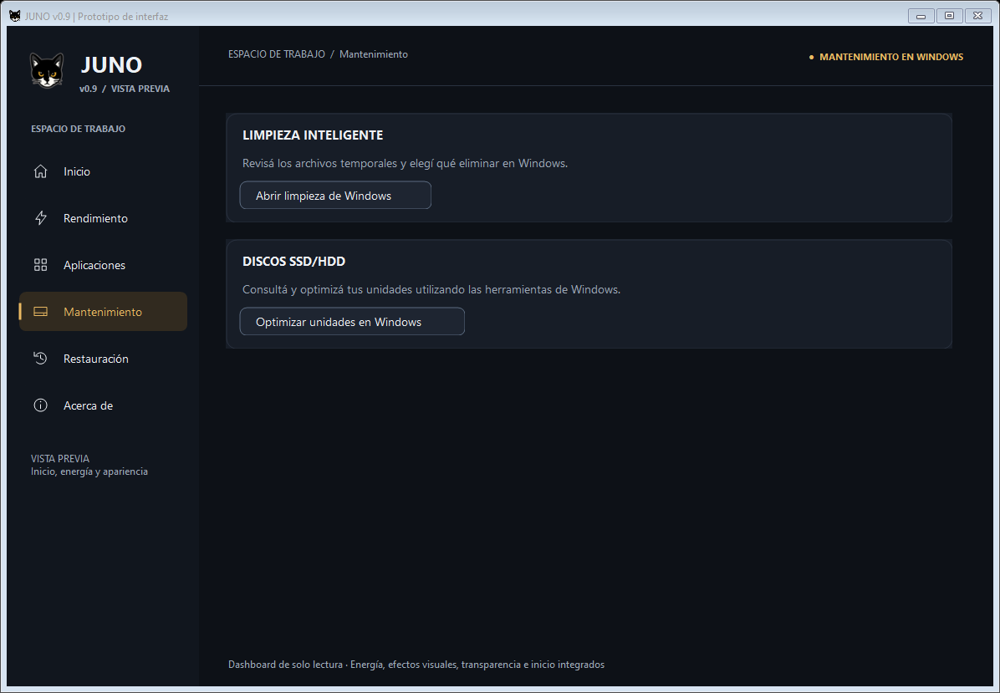
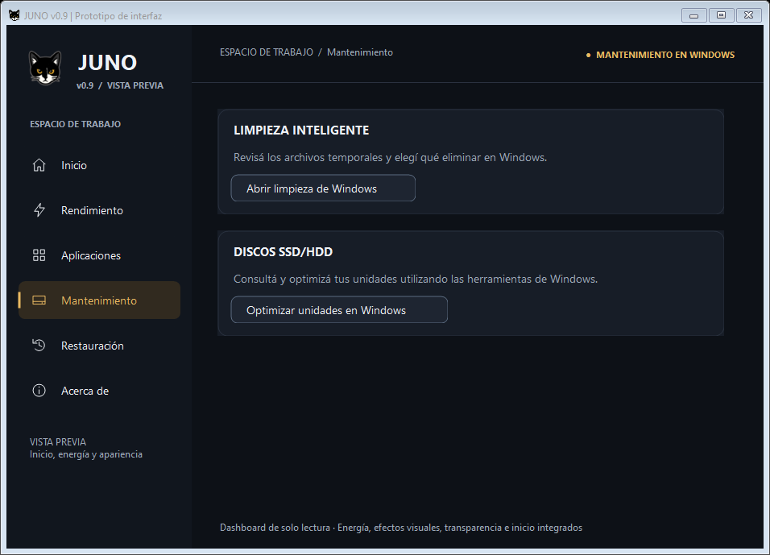
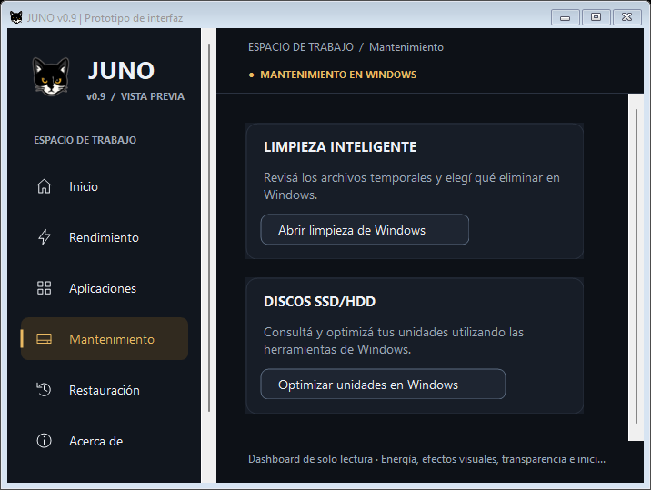
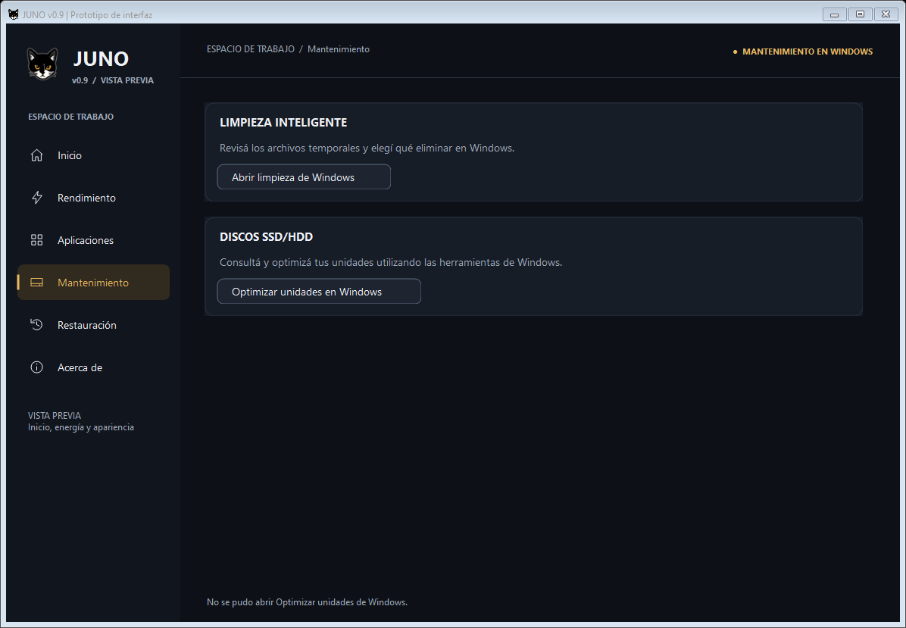

# JUNO v0.9 — Integración de Discos SSD/HDD

Fecha: 2026-10-22. Rama: feature/juno-ui-0.9.

## Consolidación previa de Limpieza

Commit local be0bba0 — feat: integrate safe Windows cleanup access. Incluye exclusivamente dos archivos de interfaz, tres archivos de pruebas, el informe de Limpieza y sus cuatro capturas. Se comprobó una exportación exacta del índice: 170/170 pruebas en PowerShell 5.1 x86 y 170/170 en x64, compilación C# y sintaxis de 43 scripts correctas.

Quedaron fuera y preservados los cinco archivos de diagnóstico de persistencia de efectos visuales, iconos, Nueva carpeta/, cambios pendientes de StartupAdapter.ps1, ui/StartupModel.cs y tests/StartupBridge.Tests.ps1, y el informe y las capturas históricos de la tabla de inicio rechazada. No se realizó push ni merge.

## Auditoría del motor, antes de implementar la interfaz

Se revisaron Discos.ps1 completo, UiSupport.ps1, RecoveryOperations.ps1, las consultas del dashboard, las pruebas de regresión y el informe de la Etapa 5 de v0.8.1.

| Función | Disponibilidad y límites reales |
| --- | --- |
| Volúmenes y capacidad | Win32_LogicalDisk con DriveType=3 y letra; capacidad y libre proceden de Windows. Excluye volúmenes sin letra y unidades reportadas como extraíbles; un disco USB puede aparecer si Windows lo clasifica como fijo. |
| Asociación física | Get-Partition → Get-Disk; el tipo se busca en Get-PhysicalDisk por serie o, como alternativa, por nombre único. No se asocian discos por posición en una lista. |
| SSD/HDD | Solo devuelve SSD, HDD o SCM si hay un candidato único con ese MediaType; ante ausencia o ambigüedad muestra No detectado. La alternativa por nombre no prueba identidad física y puede ser insuficiente en configuraciones especiales. |
| Externos y virtuales | Dependen de los proveedores, bus y asociaciones disponibles. No se infiere SSD/HDD por capacidad, letra o número de disco. Errores de Storage dejan campos desconocidos; si falla CIM, puede fallar la consulta principal. |
| Salud y SMART | HealthStatus es un estado comunicado por Windows. Los contadores opcionales de fiabilidad solo se consultan para la selección. Acceso, espacio libre o Healthy no certifican salud física, temperatura, vida útil ni SMART completo. |
| TRIM | fsutil consulta la política global NTFS DisableDeleteNotify; no demuestra soporte físico ni estado de cada SSD. La modificación requiere administrador, confirmación, mutex, respaldo y verificación mediante Invoke-JunoTrim. |
| Programación | Consulta ScheduledDefrag e historial si está disponible. No cambia la tarea. |
| Optimización clásica | Start-DiskOptimize exige selección, letra local válida, administrador, estado admitido y confirmación; ejecuta defrag /O /U /V. Windows decide el método. No hay mantenimiento al abrir ni desfragmentación /D forzada. |
| Acceso oficial | La ventana clásica ya abre dfrgui.exe mediante Get-JunoSystemTool. El resolvedor contempla System32 y Sysnative. |
| Protección y recuperación | Se conservan las validaciones, el diario y la restauración de TRIM. El mantenimiento físico no se convierte en una operación reversible mediante los respaldos de ajustes de JUNO. |

Los botones antiguos no estaban deshabilitados arbitrariamente: sin administrador no se habilitaban optimización ni TRIM; la optimización también se bloqueaba sin selección, durante otra operación o ante un estado que el motor no admitía. Habilitar TRIM requiere además SSD NTFS identificado y política global desactivada. Restaurar exige un respaldo existente. El optimizador de Windows era un acceso separado.

## Decisión: opción B

No se construye un diagnóstico propio ni otra tabla. La capacidad/libre ya se muestra para la unidad del sistema en el dashboard; la asociación física no cubre con garantías todas las configuraciones y el motor no ofrece una ventaja práctica sobre el optimizador oficial para esta vista.

Se ofrece únicamente DISCOS SSD/HDD, la descripción «Consultá y optimizá tus unidades utilizando las herramientas de Windows.» y Optimizar unidades en Windows. La clasificación y las operaciones se revisan dentro de Windows. JUNO no toma decisiones automáticas para SSD, HDD, externos, virtuales o desconocidos y no promete salud, temperatura, desgaste ni porcentajes de mantenimiento.

La herramienta oficial diferencia el tratamiento de los medios. Referencia: [Microsoft: desfragmentar y optimizar unidades en Windows 10/11](https://support.microsoft.com/en-us/windows/experience/storage-filemanagement/defragment-optimize-your-data-drives-in-windows), [Microsoft: defrag y selección por tipo de medio](https://learn.microsoft.com/en-us/windows-server/administration/windows-commands/defrag).

## Implementación, sin commit

Se sustituyó el espacio inactivo de discos por la sección mínima elegida. Limpieza y Discos reutilizan el mismo componente compacto WindowsSettingsSection: tres controles, fuentes y colores existentes, botón secundario con borde sutil. Limpieza conserva sus textos y dimensiones; no se rediseñaron las demás herramientas. La cabecera de Mantenimiento ahora identifica ambos accesos a Windows.

WindowsDiskSettingsLauncher resuelve dfrgui.exe en la carpeta de sistema obtenida de Windows; usa Sysnative desde PowerShell x86 sobre Windows x64. Sigue el mecanismo de resolución ya utilizado por el acceso a Opciones de energía, comprueba la existencia del ejecutable y no busca en PATH. No contiene rutas fijas de repositorio ni de instalación. La apertura usa el shell, sin argumentos, runas, esperas al cierre ni llamadas al motor clásico. Una excepción muestra una frase breve y se puede reintentar. Durante otra operación se bloquean temporalmente ambos accesos de Mantenimiento y se habilitan al terminar.

No se crean consultas de hardware en la vista moderna, tablas, porcentajes, estados de salud, indicadores ficticios ni nuevos botones de diagnóstico. No se ejecutan defrag, TRIM, CHKDSK, cambios de tarea, cierres de procesos, reparaciones o restauraciones. Discos.ps1 y los motores, respaldos y recuperación anteriores permanecen intactos; el módulo clásico sigue ofreciendo sus consultas y recuperación de TRIM.

## Corrección localizada del desplazamiento

El reproductor del commit aprobado be0bba0 mostró que, tras reducir de 1180 a 700 píxeles, el contenido ya tenía ancho 372, pero el área virtual de ContentViewport conservaba ancho 901 frente a un cliente de 453. La barra horizontal correspondía a ese ancho virtual anterior, no a un control que necesitara más espacio. Recalcular el panel con PerformLayout después de establecer los límites finales del contenido redujo el área virtual al ancho actual y retiró la barra.

Se añadió ese recálculo al final de LayoutPage, sin ocultar barras por la fuerza, cambiar márgenes, eliminar contenido ni modificar el diseño de otras secciones. Se prueban las seis secciones con la secuencia 1180 → 940 → 700 → 940 → 1180 → 700, la conservación del desplazamiento vertical y su reinicio al navegar. La comprobación WinForms mostró anchos de cliente/área virtual iguales: 950/950, 710/710 y 453/453, sin barra horizontal.

## Archivos modificados de esta integración

- ui/JunoShell.cs: componente compacto reutilizable, sección Discos, conexión del acceso oficial y recálculo localizado del área desplazable.
- ui/PowerPlatform.cs: IDiskSettingsLauncher y WindowsDiskSettingsLauncher.
- tests/Power.TestSupport.cs: lanzador de discos controlado y captura de sus parámetros.
- tests/DiskUi.Tests.ps1: 13 casos de contenido, navegación, apertura, errores, permisos simulados, bloqueo temporal, tamaños y ausencia de operaciones automáticas.
- tests/DiskAudit.Tests.ps1: 16 casos aislados sobre funciones de consulta del motor clásico, con datos ficticios.
- tests/UiPrototype.Tests.ps1: expectativas de herramientas pendientes y dos regresiones de redimensionamiento/desplazamiento.
- tests/CleanupUi.Tests.ps1: referencias a la cabecera conjunta y al nuevo acceso de discos, sin alterar su función.
- Este informe y cuatro capturas en docs/preview-0.9-discos/.

## Validación visual real y apertura de Windows

Se ejecutó y mostró una ventana WinForms nativa con proveedores ficticios, se navegó y redimensionó y se capturó su renderizado mediante DrawToBitmap. Se inspeccionaron las cuatro imágenes. Esto comprueba la presentación real de WinForms; no es una maqueta ni certifica una sesión completa de clics humanos. Las pulsaciones y errores se verifican con lanzadores simulados.

Las secciones miden 131 píxeles de alto a 1180×790 y 940×650, y 150 a 700×500. La descripción se adapta y los controles quedan dentro de sus límites. No aparece la barra horizontal al reducir ni al volver a ampliar. Se verificó también el aviso de error.

Se ejecutó el lanzador real de producción en Windows 11. Fuera del aislamiento de pruebas se comprobó mediante el inventario de ventanas de Computer Use la aparición de Optimizar unidades, perteneciente a Windows/System32/dfrgui.exe. No se pasó ningún argumento de mantenimiento ni se pulsó Analizar, Optimizar o Cambiar configuración. La captura del contenido de esa aplicación quedó pendiente porque venció su permiso de Computer Use. No se utilizó otro método para eludir esa limitación.

## Pruebas y resultados

- Consolidación de Limpieza: 170/170 sobre el contenido exacto del índice en x86 y x64, sin fallos ni casos omitidos. Compilación C# y sintaxis de los 43 scripts versionados correctas.
- Integración de Discos: 314/314 pruebas relevantes en PowerShell 5.1 x86 y 314/314 en x64, sin fallos ni casos omitidos. Suites DiskUi, DiskAudit, CleanupUi, UiPrototype, ConfigurationButtons, Startup, Ux, Power, Transparency, Visual y Regression. No se repitió la suite completa del repositorio en esta etapa.
- Se cubren SSD, HDD y SCM identificados, ausencia o duplicidad de proveedores, tipos desconocidos, buses USB y virtuales sin identificación, capacidad/libre de CIM, fallos y permisos insuficientes con proveedores ficticios. Se importan únicamente funciones de lectura mediante AST, sin ejecutar la inicialización ni la ventana clásica.
- El inventario no consulta contadores de fiabilidad al listar. Los contadores no disponibles permanecen nulos. La vista moderna nunca presenta esos resultados ni decide mantenimiento a partir de ellos.
- Compilación C# desde el punto de entrada Juno-Prototipo.ps1 -LoadOnly y sintaxis de los 48 scripts activos: correctas en x86 y x64. Nueva carpeta/ se conserva fuera de ese recuento.
- git diff --check y comprobaciones de espacios de archivos nuevos: correctas.
- 51 huellas SHA-256 de archivos protegidos y motores coinciden con las tomadas antes de las operaciones correspondientes. Se conservan la investigación de persistencia, iconos, archivos ajenos, Discos.ps1, Limpieza.ps1, UiSupport.ps1, respaldos y recuperación. El problema anterior de persistencia de efectos visuales no se declara resuelto.
- El índice queda vacío después del commit be0bba0. La integración de Discos, la corrección de desplazamiento, sus pruebas y capturas quedan sin commit. Sin push ni merge.

## Compatibilidad portable y límites pendientes

No se agregó ninguna dependencia que el usuario deba instalar, ejecutable auxiliar ni ruta fija de repositorio. La integración utiliza los componentes C# existentes y la herramienta de Windows; las rutas de sistema se calculan en ejecución. No se comenzó el empaquetado de JUNO.exe.

Windows 10 requiere comprobación física del acceso y la presentación. La resolución se probó en procesos reales x86/x64 del equipo Windows 11 disponible. También queda pendiente la inspección del contenido del optimizador por la limitación de permiso descrita arriba. No se certifican mantenimiento real, estados de hardware ni compatibilidad de dispositivos externos/virtuales mediante estas simulaciones.

## Comprobación manual segura

En Windows 10 y 11, abrir Abrir-Juno-Prototipo.cmd sin solicitar elevación, entrar en Mantenimiento y pulsar Optimizar unidades en Windows. Comprobar el título del optimizador y sus unidades. No pulsar Analizar, Optimizar, Cambiar configuración ni alterar programación o TRIM durante esta verificación. Volver a JUNO, navegar, redimensionar y verificar que los accesos de Limpieza, Energía, Transparencia, Efectos visuales e Inicio se conservan.

Windows puede solicitar sus propios permisos para ciertas acciones. JUNO no solicita runas ni inicia mantenimiento. La apertura puede fallar en instalaciones sin la herramienta; debe mostrar un mensaje breve y permitir reintentar.
