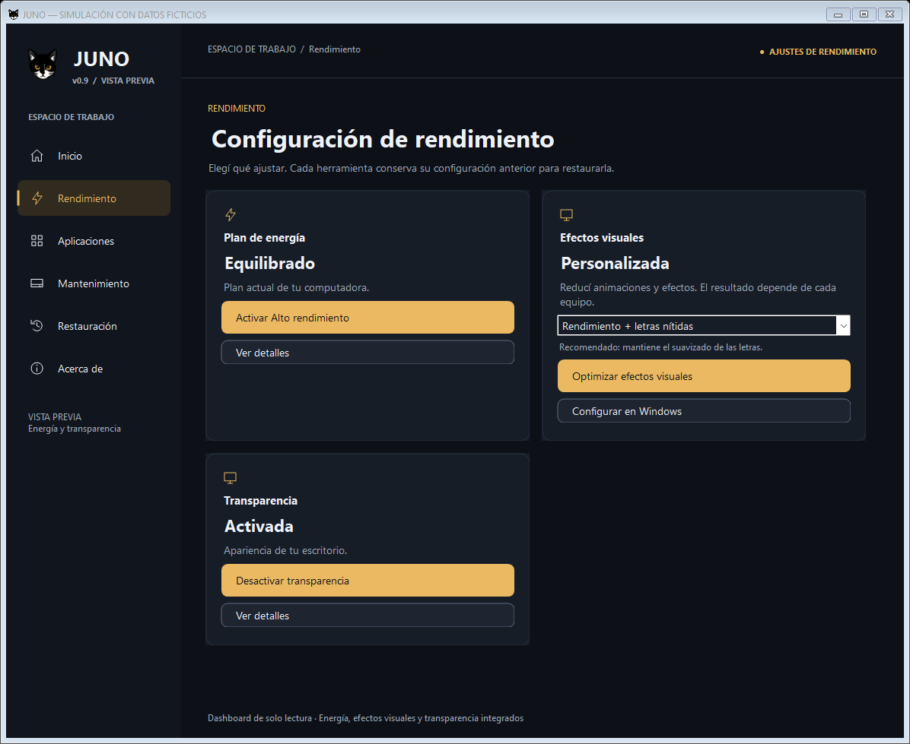
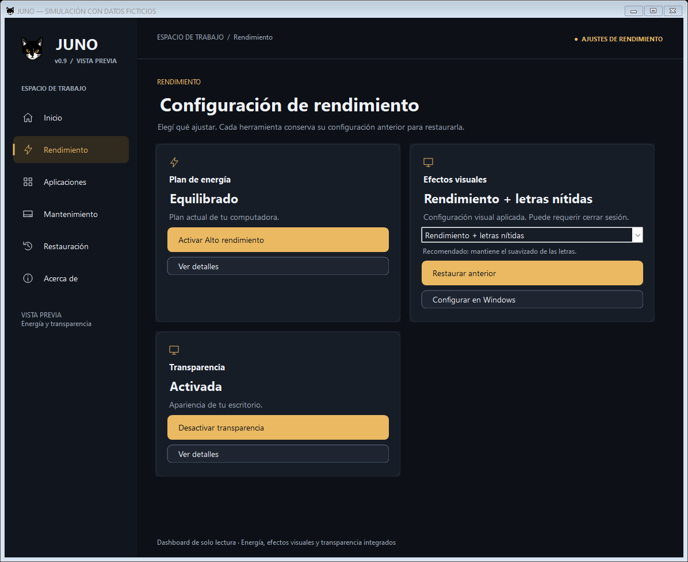

# JUNO v0.9 — Configurar efectos visuales en Windows

Corrección de interfaz posterior a la Etapa 3C. Rama `feature/juno-ui-0.9`.

## Cambio

La tarjeta Efectos visuales sustituye **Ver detalles** por **Configurar en Windows**, con el mismo estilo secundario oscuro y borde. Se conservan selector, acción principal, restauración y distribución. Las demás herramientas mantienen sus botones.

La apertura reutiliza **Get-JunoSystemTool** de UiSupport.ps1, que ya admite `SystemPropertiesPerformance.exe`. Resuelve System32 en procesos nativos y Windows x86, o Sysnative desde PowerShell x86 sobre Windows x64. No busca en PATH ni abre Propiedades del sistema generales.

El lanzador crea un runspace privado únicamente para resolver la ruta mediante el soporte existente. Inicia el ejecutable con ruta absoluta, sin argumentos, `runas` ni elevación solicitada por JUNO. Libera el handle del proceso sin esperarlo ni cerrar su ventana. No se envía ninguna solicitud al motor visual, se muestra confirmación de JUNO ni se altera la instantánea o la elegibilidad de restauración al abrirlo.

El usuario decide qué cambiar en la ventana oficial. Para consultar después:

- Con el foco en la tarjeta, **F5** actualiza el estado mediante la consulta existente.
- Clic derecho o **Shift+F10** en los controles de la tarjeta ofrece **Actualizar estado** y **Diagnóstico**.
- **F1**, con el foco en la tarjeta, abre el diagnóstico anterior, que también conserva su botón Actualizar.

Estas opciones se anuncian en la ayuda emergente y descripción accesible de Configurar en Windows, sin añadir texto técnico permanente a la tarjeta. No se consulta ni restaura automáticamente al abrir o cerrar la ventana externa. Si una lectura posterior detecta cambios manuales incompatibles con el respaldo, se mantiene el bloqueo existente.

Durante solicitudes activas de JUNO, el botón se deshabilita; el controlador de su evento también rechaza una apertura programática incompatible. Un fallo de apertura muestra **«No se pudo abrir la configuración de Windows.»** y conserva la excepción completa en Diagnóstico, sin cambiar el resultado del motor ni sus permisos.

## Archivos de esta corrección

| Archivo | Modificación |
| --- | --- |
| `ui/JunoShell.cs` | Sustitución del botón; lanzador inyectable; actualización del mensaje sin reconstruir controles; menú contextual y atajos de consulta/diagnóstico. |
| `ui/VisualModel.cs` | Interfaz y lanzador oficial; las clases de presets, resultados y controlador conservan su lógica. |
| `tests/Visual.TestSupport.cs` | Doble de apertura sin procesos reales. |
| `tests/Visual.Tests.ps1` | Pruebas de botón, resolución, apertura simulada, errores, diagnóstico, actualización, conflicto y geometría. |
| `docs/0.9-efectos-configurar-windows.md` | Este informe. |
| `docs/preview-0.9-efectos-windows/` | Dos capturas con datos ficticios, revisadas visualmente. |

Los cambios pendientes de Etapa 3C se conservan. Los informes y capturas anteriores no se sustituyen. No se modifica UiSupport.ps1, el motor visual, presets, adaptadores, respaldos, restauraciones, mutex, otras herramientas, dashboard ni icono.

La comparación SHA-256 con el inicio de esta solicitud confirma que ningún script de la raíz cambió y que las únicas fuentes C# modificadas son JunoShell.cs y VisualModel.cs. Al excluir la nueva clase de apertura, VisualModel.cs conserva exactamente el contenido previo de resultados y controlador.

## Validación

Windows PowerShell **5.1.22621.6133**, Pester **3.4.0**:

| Comprobación | x64 | x86 |
| --- | --- | --- |
| Suite completa | **629/629 aprobadas**, 0 fallos, 0 omitidas | **629/629 aprobadas**, 0 fallos, 0 omitidas |
| Sintaxis PowerShell | **37 scripts**, correcta | **37 scripts**, correcta |
| Compilación C# mediante `-LoadOnly` | Correcta | Correcta |

Se conservan los 614 casos anteriores y se añaden **15 casos**. La ejecución focalizada aprobó **50/50**, y la repetición de interfaz tras comprobar F5 con conservación del foco aprobó **21/21**. `git diff --check`: sin incidencias.

Los casos nuevos comprueban el botón y estilo secundario, ausencia del anterior en esta tarjeta, conservación de los botones de otras herramientas, apertura simulada sin consultas/escrituras/confirmaciones, restauración intacta, fallo breve con diagnóstico completo, bloqueo durante operaciones, consulta manual y conflicto posterior sin restauración automática, acceso contextual al diagnóstico, F5 tras abrir y distribución a 1180/940/700 píxeles.

La resolución usa copias del UiSupport real con arquitectura y existencia simuladas: Windows x64/proceso x64, Windows x64/proceso x86 y Windows x86/proceso x86, además de herramienta ausente. Los procesos de prueba no abren SystemPropertiesPerformance.exe ni aplican optimizaciones reales. La suite anterior conserva las pruebas del motor que detectan cambios externos, conflictos y restauraciones parciales.

## Capturas y límites

**Simulaciones con datos ficticios. No muestran cambios reales de Windows.**

Queda pendiente comprobar la apertura y presentación de la ventana nativa en equipos reales con Windows 10 y 11. Si el ejecutable falta o Windows impide abrirlo, JUNO informa el error; no usa otro ejecutable de PATH ni intenta elevarse para eludirlo. Las modificaciones realizadas por el usuario en esa ventana se reflejan en JUNO después de actualizar, con las mismas comprobaciones de conflicto y recuperación existentes.

No se realiza commit, push ni integración de otros módulos.
