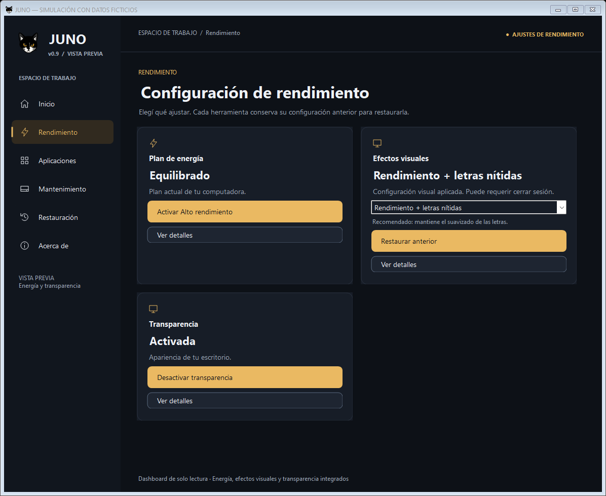
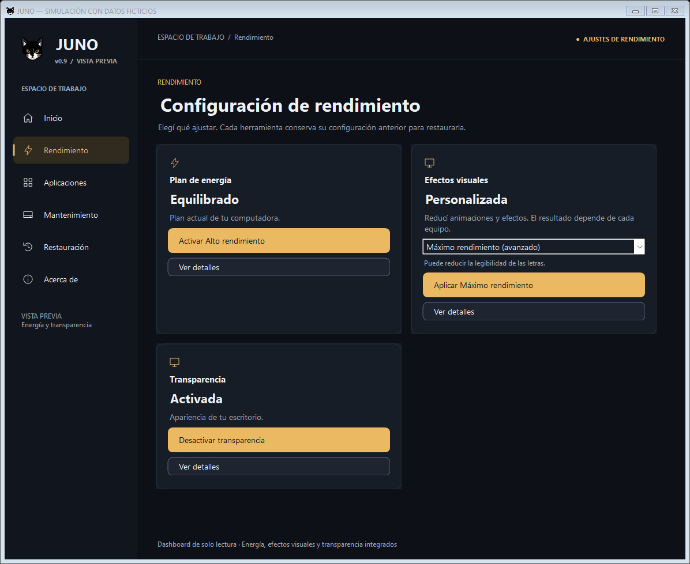
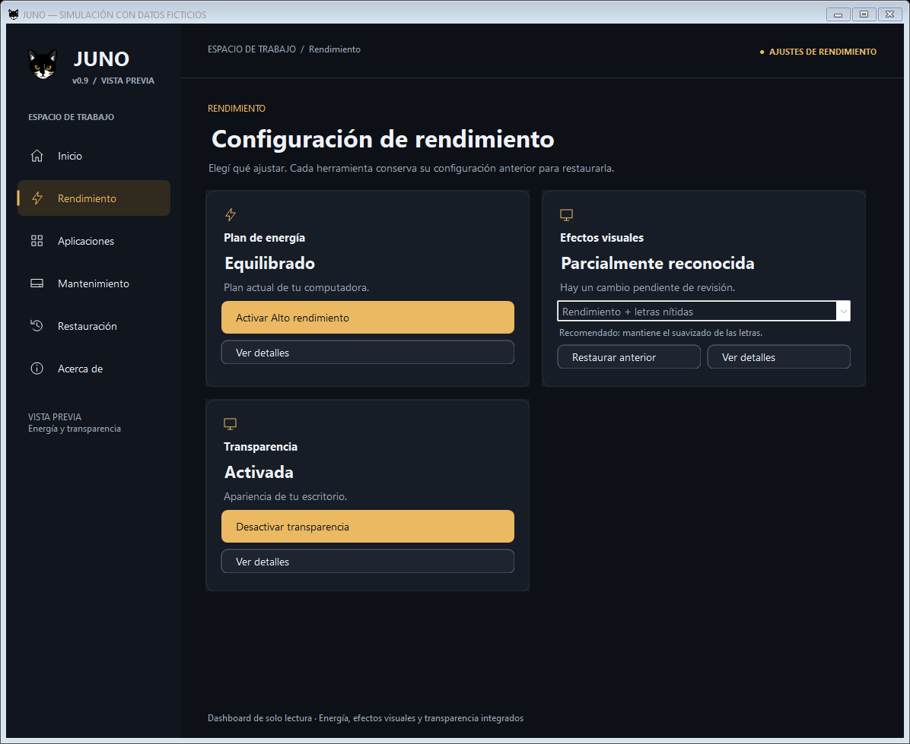
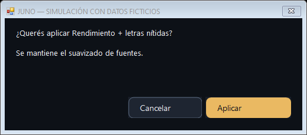
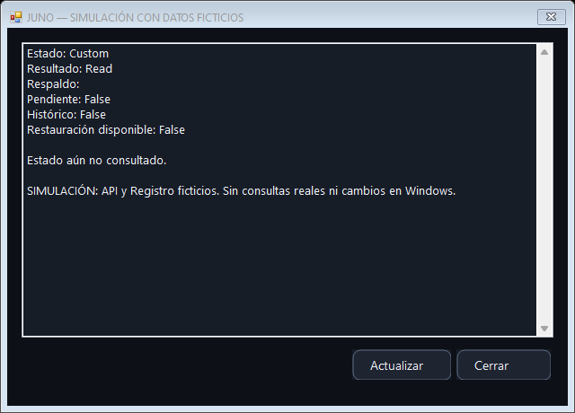

# JUNO v0.9 — Etapa 3C: Efectos visuales

Fecha: 21/10/2026. Rama: `feature/juno-ui-0.9`.

## Preparación y commits anteriores

Antes de integrar esta herramienta se repitió la suite anterior: **571/571 pruebas aprobadas en x64 y 571/571 en x86**, con Windows PowerShell 5.1.22621.6133 y Pester 3.4.0. Sintaxis de los 33 scripts, compilación C# y `git diff --check`: correctos.

Los cambios anteriores se separaron en dos commits locales:

- **`d8e39ec` — `feat: integrate power plans with duplicate prevention`**: energía, integración y prevención de duplicados. La copia aislada anterior a UX aprobó sus **544/544 casos en x64**, además de la validación del estado completo en ambas arquitecturas.
- **`b458d3e` — `feat: simplify controls and confirmations for common users`**: simplificación, prioridad del plan oficial y preferencia de sesión, pruebas y capturas.

La separación se preparó mediante una copia fuera del repositorio, sin sustituir el contenido de trabajo por la versión intermedia. Se corrigió una línea vacía al final de PowerOperations.ps1 para que el primer commit pasara también `git diff --cached --check`. Solo entraron archivos de JUNO expresamente seleccionados. `Nueva carpeta/` quedó excluida.

**La Etapa 3C queda sin commit ni stage. No se realiza push ni fusión.** Los estados Git de los informes anteriores describen el momento de sus respectivas entregas.

## Arquitectura

`ShellForm → VisualController → IVisualService / PowerShellVisualService → VisualAdapter.ps1 → Invoke-JunoVisual → API y Registro del usuario actual`.

El controlador recibe instantáneas y conserva la última lectura durante una escritura. Consulta, selección de modo, confirmación, aplicación, verificación, restauración y diagnóstico permanecen separados. La selección no ejecuta cambios. El dashboard conserva su trabajador exclusivo de lectura y sus proveedores.

El servicio visual utiliza una tarea de fondo con runspace privado STA y `PSThreadOptions.ReuseThread`. Adquiere, utiliza y libera `Global\JUNO.0.8.State` dentro de la misma invocación, con `finally`. La inicialización de las declaraciones nativas se realiza bajo el bloqueo. El servicio valida acciones, rechaza escrituras sin confirmación y limita la respuesta JSON a 32.768 caracteres y profundidad 8. La revisión de históricos llega al hilo de interfaz mediante el mecanismo existente de pregunta/respuesta.

Las consultas iniciales de Transparencia, Energía y Efectos visuales se secuencian. Durante una solicitud se bloquean las acciones incompatibles de las otras tarjetas; navegar sigue disponible. Una escritura difiere el cierre normal hasta recibir su resultado. No hay `Stop`, `Kill`, cancelación forzada ni timeout de escritura. Cerrar durante una lectura dispone la vista sin tocar el resultado de fondo ni invocar controles destruidos.

## Reutilización del módulo estable

`VisualEffectsOperations.ps1` extrae **diez funciones sin cambios**, comprobadas mediante sus AST contra el commit anterior:

`Get-EffectValue`, `Set-EffectValue`, `Set-UiParamSwitch`, `Get-MinimizeAnimation`, `Set-MinimizeAnimation`, `Get-CurrentEffects`, `Get-VisualRegistrySnapshot`, `Restore-VisualRegistry`, `Apply-VisualEffects` y `Restore-VisualEffects`.

También conserva las constantes `EffectCodes` y `VisualRegItems`. La interfaz anterior importa la extracción; ambas interfaces usan las mismas fronteras. Importar el archivo no consulta ni modifica Windows.

RecoveryOperations.ps1 conserva las transacciones de `Invoke-JunoVisual`, `Get-JunoVisualState`, `Set-JunoEffects` y `Test-JunoVisualTarget`. El bloque puro que construía el preset se extrae a `Get-JunoVisualPreset`, utilizado tanto por el motor como por el reconocimiento del adaptador. Así no se duplica una segunda definición de lo que significa cada modo. Las comprobaciones, escrituras, diarios y restauración no cambian.

Se consultan los **14 indicadores API** existentes: UIEffects, ClientAreaAnimation, MenuAnimation, ComboBoxAnimation, ListSmoothScrolling, MenuFade, SelectionFade, ToolTipAnimation, ToolTipFade, CursorShadow, DropShadow, MinimizeAnimation, FontSmoothing y DragFullWindows. Se conservan los diez valores de Registro existentes: VisualFXSetting, TaskbarAnimations, IconsOnly, ListviewAlphaSelect, ListviewShadow, EnableAeroPeek, DragFullWindows, FontSmoothing, UserPreferencesMask y MinAnimate. **EnableTransparency no pertenece al preset visual.**

Los presets siguen siendo los existentes:

| Modo | Comportamiento |
| --- | --- |
| Rendimiento + letras nítidas | Reduce los efectos contemplados y conserva FontSmoothing activado. Es la selección inicial recomendada. |
| Máximo rendimiento | Aplica el preset existente más agresivo, con FontSmoothing desactivado. Requiere elegir la alternativa avanzada y confirmar su consecuencia sobre la legibilidad. |

No se agregan ajustes, cambios de ClearType, valores nuevos de accesibilidad ni modificaciones de transparencia. No se garantiza una mejora universal de rendimiento.

Referencia primaria de los contratos nativos existentes: [SystemParametersInfoW, Microsoft](https://learn.microsoft.com/en-us/windows/win32/api/winuser/nf-winuser-systemparametersinfow). FontSmoothing y DragFullWindows utilizan `uiParam`; los BOOL de los efectos conservan su paso por valor en `pvParam`. La declaración existente `ANIMATIONINFO` conserva 8 bytes y `iMinAnimate` en offset 4 en ambos hosts.

## Estado reconocido y tarjeta

Un preset se reconoce únicamente cuando coinciden los 14 resultados API y sus nueve valores explícitos de Registro. `UserPreferencesMask` se respalda y restaura, pero no se interpretan ni predicen bytes internos para afirmar un preset.

| Estado | Qué demuestra |
| --- | --- |
| Administrada por Windows | VisualFXSetting indica elección administrada por Windows, sin contradicciones en las parejas API/Registro comprobadas. No certifica valores universales de fábrica. |
| Personalizada | Lectura completa válida que no coincide con un preset ni con el marcador anterior. |
| Rendimiento + letras nítidas / Máximo rendimiento | Coincidencia completa del preset definido por el motor. |
| Parcialmente reconocida | Diferencias entre API y Registro, o solo coincidencia parcial con un preset. No se anuncia como optimizada. |
| Estado desconocido | Lectura fallida o incompleta. No se habilita aplicar ni restaurar mientras no pueda obtenerse el estado completo previo. |

Una configuración parcialmente reconocida puede ajustarse únicamente si las 14 lecturas y diez entradas son completas y válidas y el respaldo permite operar: su estado original completo se guarda antes de aplicar. Una lectura incompleta no cumple esa condición. Un diario pendiente o histórico bloquea nueva aplicación; restaurar conserva la revisión del motor. Una operación previamente parcial mantiene un aviso incluso después de volver a consultar.

La tarjeta presenta nombre, estado, mensaje breve, selector compacto y una acción principal. Si el modo seleccionado ya está activo, no ofrece repetirlo; destaca restaurar si está disponible. Si aplicar es incompatible, oculta ese botón. «Restaurar anterior» y «Ver detalles» mantienen un estilo secundario identificable. Durante una escritura siguen visibles, deshabilitados, los controles del estado anterior hasta la verificación.

El recomendado necesita **Optimizar → confirmar**; el avanzado necesita además cambiar el selector. Hay una sola confirmación habitual de 520 × 230 píxeles lógicos, con Cancelar predeterminado para Enter y Escape. Los históricos/interrupciones mantienen una revisión adicional porque autoriza el uso de información anterior, no la mera repetición de la misma operación.

Detalles ofrece lectura de API, Registro, originales visuales, diario, conflictos, errores y recuperación, junto con Actualizar. Las claves, parámetros y nombres API no aparecen en la tarjeta. El tema, Segoe UI, icono, menú y distribución general se conservan.

## Respaldos y seguridad

Se reutiliza **General/User**, su identidad SID/equipo, validación estricta, original, reemplazo atómico, previous/history y diario `Journal.Visual`. No se crea un almacén paralelo ni se cambia el formato. `Get-Backup` y `Save-Backup` siguen siendo compartidos por Transparencia y Efectos visuales.

- Antes de modificar, el motor relee el estado, conserva el primer original y guarda intención. Revalida después de guardar y antes de escribir.
- La consulta no concilia diarios, crea carpetas, importa históricos ni escribe respaldos.
- Después de API y Registro se releen los valores. Un error o falta de coincidencia se informa como fallo y conserva originales y fase parcial. Si ni siquiera se puede leer, permanece Pending.
- Una configuración externa distinta de Confirmed bloquea las escrituras incompatibles. Un estado pendiente se revisa explícitamente al recuperar, como en el motor anterior.
- Restaurar respeta valores existentes y ausencias originales. Los respaldos históricos válidos, incluidos subconjuntos permitidos, conservan su revisión y verificación.
- Visual no modifica `TransparencyBackup` ni `Journal.Transparency`; Transparencia no borra los originales ni el diario visual. La suite comprueba ambas restauraciones en el almacén compartido.
- El adaptador revalida y el motor vuelve a hacerlo bajo el mutex: los botones y la instantánea anterior no constituyen autorización para omitir esas comprobaciones.
- No se solicita administrador para efectos del usuario actual ni se cambia de cuenta. No se agrega elevación.
- No se reinicia Explorer, se cierra sesión, modifica Defender, servicios, Windows Update ni ningún módulo adicional.

BackupStore.ps1, VisualInterop.ps1, motores/adaptadores de Transparencia y Energía, sus proveedores y las fuentes del dashboard conservan su contenido respecto de `b458d3e`. En la interfaz compartida solo se añaden la tarjeta, coordinación y textos necesarios.

## Archivos

| Archivo | Cambio |
| --- | --- |
| `VisualEffectsOperations.ps1` | Extracción compartida de las fronteras y constantes visuales existentes. |
| `VisualAdapter.ps1` | Consulta, reconocimiento verificable, elegibilidad, diagnóstico y delegación al motor. |
| `ui/VisualModel.cs` | DTO, servicio, controlador y presentación de estados. |
| `ui/PowerShellVisualService.cs` | Puente STA con revisión, mutex y respuesta acotada. |
| `Juno.ps1` | Importación de la extracción; deja de duplicar las funciones. |
| `RecoveryOperations.ps1` | Extracción pura de la construcción del preset. |
| `Juno-Prototipo.ps1` | Compilación e inyección de la nueva herramienta. |
| `ui/JunoShell.cs` | Tarjeta, selector, detalles, sondeo, cierre seguro y coordinación entre herramientas. |
| `ui/TransparencyConfirmation.cs` | Etiqueta «Aplicar» para la confirmación visual; conserva el diálogo compartido y Cancelar predeterminado. |
| `tests/Visual.Tests.ps1`, `tests/VisualBridge.Tests.ps1`, `tests/Visual.TestSupport.cs` | Simulaciones de motor, puente, almacén, concurrencia y UI. |
| Pruebas Dashboard, Power, PowerBridge, Transparency y Ux | Solo se incorporan las dependencias y el fixture a su compilación conjunta. |
| Pruebas BackupOperations y Regression | Apuntan a la extracción y conservan el bootstrap desde rutas con espacios. |
| Pruebas UiPrototype | Rendimiento ya no tiene una tarjeta pendiente de integración. |
| `docs/0.9-etapa3C.md`, `docs/preview-0.9-etapa3C/` | Informe y seis capturas ficticias. |

## Pruebas

Validación final con Windows PowerShell **5.1.22621.6133** y Pester **3.4.0**:

| Comprobación | x64 | x86 |
| --- | --- | --- |
| Suite completa | **614/614 aprobadas**, 0 fallos, 0 omitidas | **614/614 aprobadas**, 0 fallos, 0 omitidas |
| Sintaxis PowerShell | **37 scripts**, sin errores | **37 scripts**, sin errores |
| C# / bootstrap `-LoadOnly` | Compilación correcta | Compilación correcta |
| ANIMATIONINFO / offset iMinAnimate | 8 / 4 bytes | 8 / 4 bytes |

Se conservan los **571 casos anteriores** y se añaden **43 casos visuales**: 1.228 ejecuciones aprobadas entre ambas arquitecturas. La repetición focalizada de motor visual, puente, geometría y UX aprobó además **98/98**. `git diff --check` termina sin incidencias.

La nueva cobertura incluye consulta sin escrituras, marcador administrado y configuración personalizada, ambos presets, conservación del suavizado en el recomendado, cancelación, aplicación y repetición, errores API/Registro, consulta posterior ilegible, guardado fallido, aplicaciones/restauraciones parciales, recuperación y reintento, ausencias originales, histórico válido/cancelado/incompatible, conflicto externo, pendientes, revalidación previa, mutex ocupado y preservación de los dos diarios compartidos.

El puente se prueba realmente con runspaces, archivos privados y mutex únicos, reemplazando las fronteras nativas por almacenamiento ficticio. Se comprueban identidad, copias previas, revisión histórica, doble solicitud y coordinación entre servicios. La UI utiliza servicios controlados: predeterminado recomendado, avanzado explícito, una confirmación compacta, ocultación de aplicación incompatible, restauración única, navegación, cierre seguro, información técnica y actualización del resultado.

También se ejecuta toda la regresión anterior, incluidas geometría, navegación, scroll, escalas lógicas 100/125/150/200 %, ABI x86/x64 y bootstrap anterior. Las pruebas de escritura usan exclusivamente simulaciones y respaldos ficticios. No se ejecutan ajustes reales de Windows.

## Capturas ficticias

Cada ventana está rotulada **SIMULACIÓN CON DATOS FICTICIOS**. Las imágenes se generaron con proveedores controlados y se inspeccionaron visualmente; no representan modificaciones ni consultas de configuración del equipo.

## Compatibilidad y límites

El host previsto sigue siendo Windows PowerShell 5.1 y .NET Framework, en Windows 10/11 x86/x64. No se certifica PowerShell 7. No se incorporan API ni parámetros nuevos: se reutilizan los del módulo anterior. Una lectura no soportada o incompleta bloquea la escritura, sin inventar un respaldo.

La evidencia automatizada verifica contratos y recuperabilidad mediante simulaciones; **no certifica aquí el efecto visible real en cada edición/build, sesión remota, tema, controlador gráfico o política corporativa**. Las aplicaciones pueden ignorar efectos, y algunas superficies solo se actualizan después de un cierre de sesión manual. No se promete fluidez universal ni el mismo resultado visual en todos los equipos.

UserPreferencesMask es opaco y puede cambiar como efecto de SPI; se conserva para restaurar y para detectar cambios del estado confirmado, sin interpretar su codificación. El mutex coordina JUNO, pero programas externos pueden cambiar preferencias fuera del bloqueo. El motor conserva sus comprobaciones, sin prometer una transacción atómica de Windows para todas las API.

Una interrupción o proveedor bloqueado puede requerir recuperar posteriormente el diario. No se fuerza un timeout ni se cancela una escritura para cerrar la ventana. Respaldo incompatible o conflicto requieren revisar, no borrar archivos o cambiar identidades/ACL para eludir el bloqueo.

## Validación manual posterior en Windows 10 y Windows 11

**Procedimiento preparado, no ejecutado durante el desarrollo. Aplicar y restaurar requieren una prueba real autorizada posteriormente.** Registrar edición/build, arquitectura, escala, cuenta y posibles políticas. Usar la misma cuenta durante todo el ciclo; no hace falta abrir como administrador para efectos del usuario.

1. Abrir `Abrir-Juno-Prototipo.cmd`, entrar en Rendimiento y esperar la consulta. Abrir Ver detalles de Efectos visuales y registrar estado API/Registro. Si hay error, conflicto, histórico o lectura incompleta, detener la aplicación de presets y revisar su diagnóstico.
2. Registrar por separado el estado de Transparencia en su tarjeta y detalles. Anotar si existe su original pendiente de restaurar. No modificar Transparencia durante este ciclo.
3. Comprobar que el modo seleccionado inicialmente es Rendimiento + letras nítidas. Pulsar Optimizar y cancelar la primera confirmación: el estado y los respaldos deben permanecer sin cambios.
4. Solo con autorización para la prueba real, repetir y confirmar. Durante la operación navegar por las secciones, verificar bloqueos y que el cierre normal espere. Al terminar comprobar mensaje, 14 indicadores, nueve valores explícitos del preset y FontSmoothing activado. No tomar el nombre del preset ni VisualFXSetting por prueba suficiente por sí solos.
5. Confirmar que Transparencia conserva estado, original y diario. El preset visual no debe cambiar EnableTransparency. Si el efecto visible tarda, anotarlo; JUNO no reinicia Explorer ni cierra sesión.
6. Pulsar Restaurar anterior, revisar su única confirmación normal y confirmar solo dentro de la prueba autorizada. Si aparece revisión histórica/interrupción, leer la evidencia y cancelar si no se conoce su procedencia.
7. Comparar API, valores, tipos y ausencias con lo registrado al inicio. Deben quedar sin restauración visual pendiente y conservarse los datos de Transparencia. No exigir que el nombre mostrado vuelva a «Predeterminada» si el original era personalizado.
8. Repetir en Windows 10 y 11 con la misma ficha; anotar diferencias visuales, DPI y necesidad de cerrar sesión manualmente. No manipular el Registro ni provocar caídas para simular fallos: esos casos pertenecen a las pruebas ficticias.
9. Máximo rendimiento es opcional y requiere autorización aparte dentro de la prueba real: elegirlo explícitamente, comprobar que advierte sobre legibilidad, aplicar, verificar y restaurar. No usarlo como valor predeterminado.
10. Ante fallo, conservar originales, diario y copias. Consultar nuevamente; si quedó pendiente, usar el flujo de recuperación revisado. No cerrar procesos ni borrar respaldos para completar la prueba.

## Continuación

Completar primero esa matriz manual y revisar cualquier diferencia de API/Registro o restauración antes de integrar otro módulo. No generar todavía un ejecutable final. La Etapa 3C se entrega local, sin commit, push ni fusión, para revisión.
