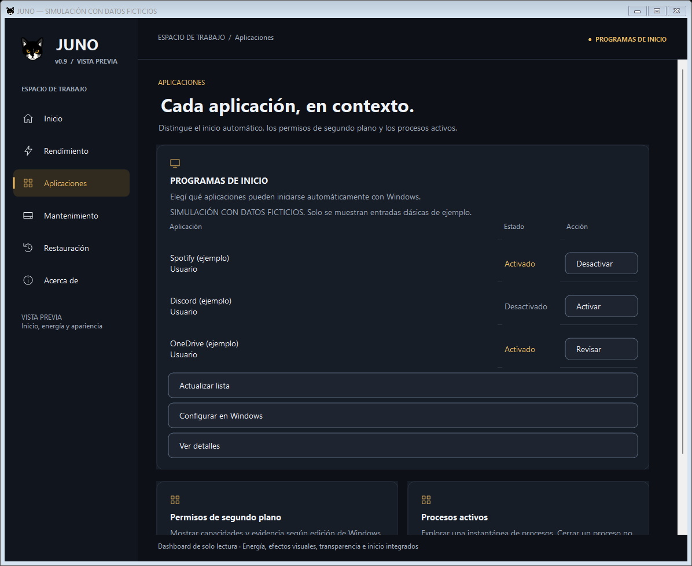
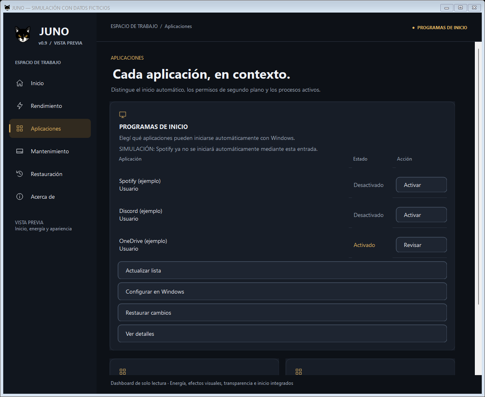
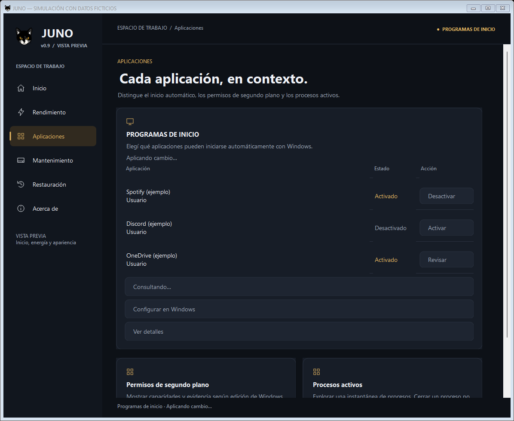
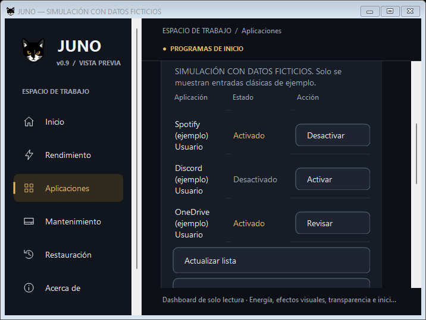

# JUNO v0.9 — Etapa 3D: Programas de inicio

Fecha: 21/10/2026. Repositorio: `C:\GitHub\Juno`. Rama: `feature/juno-ui-0.9`.

## Preparación y estado Git

Antes de modificar código se revisaron la Etapa 3C y la corrección «Configurar en Windows». Se repitieron **629/629 pruebas en x64 y 629/629 en x86**, con cero fallos y cero omitidas, usando Windows PowerShell **5.1.22621.6133** y Pester **3.4.0**. Los 37 scripts pasaron el análisis de sintaxis; el bootstrap C# `-LoadOnly` compiló en ambos hosts; `git diff --check` y `git diff --cached --check` aprobaron.

Se comprobó mediante AST que las diez funciones visuales extraídas conservaban su implementación. El commit local **`31f3384` — `feat: integrate visual effects with Windows settings access`** contiene únicamente la Etapa 3C y su corrección: 30 archivos. `Nueva carpeta/` quedó excluida; después del commit era el único elemento pendiente.

**La Etapa 3D queda sin commit ni stage.** No se realiza push, fusión, empaquetado ni generación del ejecutable final. Los estados Git de los informes anteriores describen sus entregas históricas. La carpeta ajena `Nueva carpeta/` permanece intacta y excluida.

## Arquitectura

`ShellForm → StartupController → IStartupService / PowerShellStartupService → StartupAdapter.ps1 → StartupOperations.ps1 → Windows`.

- **Vista:** lista en Aplicaciones con nombre, ámbito legible, estado y acción individual. No conoce rutas de respaldo, API del Registro ni comandos de inicio.
- **Controlador:** conserva la instantánea anterior durante la solicitud; separa lectura, elección, confirmación, ejecución y publicación del resultado. Rechaza acciones duplicadas, estados desconocidos y permisos incompatibles. La selección incluye identificador opaco, huella del origen y token del estado observado.
- **Servicio:** `Task.Run`, runspace privado STA, `PSThreadOptions.ReuseThread`, argumentos tipados y scripts constantes. La adquisición, uso y liberación del mutex pertenecen a la misma invocación/hilo. Valida el contrato JSON, limita la respuesta a 4 MiB y el inventario a 4.096 entradas.
- **Adaptador:** proyecta el motor, evalúa permisos y cautelas, vuelve a enumerar bajo el bloqueo y verifica los tokens. No escribe valores ni implementa una segunda transacción.
- **Motor:** conserva los diarios, originales, ámbitos y verificación de v0.8.1. El dashboard mantiene su trabajador exclusivamente de lectura.

No se importa ni ejecuta la interfaz antigua para operar. `StartupOperations.ps1` extrae las 17 funciones del motor de Inicio; `Inicio.ps1` importa esa extracción y conserva **Show-StartupManager sin cambios**. La comparación AST confirmó **16 funciones idénticas**; la única ampliación está en `Set-StartupState`.

## Motor reutilizado y alcance del inventario

Se reutilizan `Get-StartupEntries`, `Get-StartupFlag`, `Read-StartupRegValue`, `Get-StartupSourceFingerprint`, `Get-StartupRecommendation`, `Get-StartupBackup`, `Save-StartupBackup`, `Get-StartupApprovalSnapshot`, `Test-StartupApprovalSnapshot`, `Initialize-StartupTransaction`, `Sync-StartupTransaction`, `Write-StartupTransaction`, `Set-StartupState` y `Restore-StartupState`.

El motor enumera los valores Run del usuario actual, Run del equipo en su vista nativa, Run de 32 bits del equipo sobre Windows x64 y archivos de las carpetas Inicio del usuario/equipo. Conserva la correspondencia con StartupApproved/Run, Run32 y StartupFolder. Desde un proceso x86 sobre Windows x64 las aprobaciones de equipo siguen usando Registry64, como en el motor estable.

Solo cambia la aprobación de la entrada seleccionada. **No modifica ni elimina valores Run, comandos, accesos directos, archivos originales o ejecutables.** Tampoco administra servicios, tareas programadas, paquetes con StartupTask, RunOnce u otros mecanismos fuera del inventario estable.

La lista no se presenta como inventario completo. El motor clásico omite algunas entradas ilegibles; por eso el mensaje recuerda que otras aplicaciones o entradas no legibles pueden no aparecer. Una lectura global fallida se comunica como error. Las entradas devueltas que no pasan la validación se muestran sin autorización de cambio.

## Identidad, recuperación y concurrencia

Se conserva BackupStore.ps1 sin modificaciones: formato `JUNO.Backup` v1, tipo Startup, almacenes User/Machine, validación de SID/equipo/ámbito/destinos, ACL de equipo, guardado atómico y evidencias previous/history.

Cada registro conserva el primer estado original, incluida la ausencia del valor de aprobación. Las transacciones existentes registran intención Pending y estado Confirmed; releen antes de escribir y verifican después. El adaptador no concilia ni guarda diarios durante las consultas: inicializa y evalúa únicamente una **copia en memoria** para determinar elegibilidad.

`Set-StartupState` agrega dos parámetros opcionales compatibles con sus llamadas anteriores: huella esperada del origen y snapshot esperado de aprobación. Se comparan **antes de crear/guardar el respaldo**. Así se rechaza una sustitución de comando o cambio de aprobación que ocurra entre la validación del adaptador y la entrada al motor. `Write-StartupTransaction` conserva además su relectura posterior al guardado de intención.

La interfaz no autoriza a partir de la fila antigua: reenumera, valida el destino permitido y comprueba el origen y la aprobación. Cambios de comando, entrada eliminada, bytes externos diferentes aunque conserven el mismo estado lógico o identificadores duplicados bloquean operaciones incompatibles. Si existe un pendiente en cualquier registro, se bloquean nuevas aplicaciones en todo el administrador hasta recuperarlo; se detecta también cuando su entrada ya no aparece en el inventario.

«Restaurar cambios» usa el motor existente, que verifica cada registro por separado. Un conflicto no sobrescribe Windows; las entradas no recuperadas conservan su respaldo y se informa resultado parcial. Las entradas recuperables pueden restaurarse aunque otra tenga conflicto. Un reintento puede completar las restantes. Una operación pendiente conserva el original y ofrece recuperación; no habilita una nueva aplicación incompatible.

Los históricos válidos de usuario siguen siendo aceptados y generan evidencia al migrarse; no se inventa Confirmed a partir de una antigua intención. Los históricos de equipo mantienen la importación y revisión explícitas del motor estable. Esa autorización excepcional de procedencia puede solicitar una revisión adicional a la confirmación habitual. Cancelarla conserva los archivos.

Lecturas y escrituras usan **Global\JUNO.0.8.State**, compartido con las otras interfaces/herramientas. Una instancia competidora recibe ocupado. También hay un guardia por servicio y un guardia de confirmación en el shell que evita solicitudes reentrantes entre herramientas. No hay otro almacén o mutex paralelo.

## Permisos y aplicaciones importantes

- **Usuario actual:** no requiere elevación. Se utiliza su identidad y su respaldo.
- **Equipo:** sin un token elevado, no se permite escribir; Revisar muestra «Necesitás permisos de administrador para modificar esta aplicación». No se solicita elevación ni se inicia otro proceso/identidad para cambiarla.
- **No administrable o desconocida:** Revisar explica el bloqueo; no envía una escritura. Configurar en Windows permite consultar las alternativas oficiales.
- **Restauración:** se limita a los registros accesibles con la cuenta/permisos actuales; no asegura haber restaurado respaldos de equipo que la sesión no puede administrar.

Se mantienen las recomendaciones del motor y se aplica cautela adicional a nombre, comando expandido, fabricante declarado y ubicación en Windows. Componentes reconocidos de seguridad, hardware/controladores o del sistema quedan bloqueados. Respaldos, sincronización, VPN, hardware pendiente de revisión y entradas no identificadas muestran una advertencia dentro de la misma confirmación.

Un nombre conocido por sí solo no acredita que una entrada sea opcional: se exige además evidencia del comando/fabricante y la recomendación previa; en los demás casos se solicita revisión. Son **heurísticas conservadoras, no una certificación de seguridad, firma o autenticidad** del ejecutable. JUNO no selecciona ni desactiva todos los programas y no promete mejoras universales.

## Interfaz

Se conservan el tema oscuro, Segoe UI, dorado, icono, navegación y distribución general. Programas de inicio usa una tarjeta ancha para permitir una lista legible con las columnas Aplicación, Estado y Acción; las otras dos herramientas de Aplicaciones permanecen sin conectar.

Cada fila conserva su identidad independiente y muestra Usuario/Equipo. Los nombres largos se abrevían visualmente con ayuda emergente y nombre accesible; no se muestran permanentemente claves, rutas, bytes o identificadores. Los diagnósticos completos, incluidos los conflictos, permanecen en Ver detalles.

La operación normal tiene una sola confirmación breve, con **Cancelar predeterminado para Enter y Escape**. Revisar incorpora su advertencia en esa misma confirmación cuando puede modificarse; si está bloqueada, solo muestra el motivo. Después de verificar se informa «… mediante esta entrada», sin afirmar que la aplicación dejó de funcionar en segundo plano ni que se deshabilitaron otros mecanismos.

Al visitar Aplicaciones se realiza la primera consulta fuera del hilo principal. Después solo se consulta al pedir Actualizar lista o como parte de la verificación de una operación solicitada; navegar no provoca sondeo continuo. El temporizador de 100 ms solo publica tareas activas y se detiene al terminar. Ningún trabajador modifica controles WinForms.

Durante una solicitud se deshabilitan acciones incompatibles; la navegación sigue disponible. La fila conserva su estado anterior hasta el resultado. El cierre normal espera una escritura y permite cerrarse cuando termina; una lectura puede terminar después de disponer la vista sin acceder a controles destruidos. No se usa Stop, Kill, timeout ni cancelación forzada de una transacción.

**Configurar en Windows** es secundario y abre la URI fija `ms-settings:startupapps`, sin argumentos de usuario, confirmación, espera ni elevación solicitada por JUNO. Es la página de aplicaciones de inicio documentada por [Microsoft](https://learn.microsoft.com/en-us/windows/apps/develop/launch/launch-settings). Un error muestra un mensaje breve y conserva la excepción en Diagnóstico. Abrirla no consulta, aplica ni restaura; después de cambios manuales se usa Actualizar lista y se mantienen las comprobaciones de conflicto.

## Archivos de la Etapa 3D

| Archivo/grupo | Cambio |
| --- | --- |
| `StartupOperations.ps1` | Motor compartido extraído y dos precondiciones opcionales para la selección moderna. |
| `Inicio.ps1` | Importa el motor; mantiene la GUI clásica sin cambios. |
| `StartupAdapter.ps1` | Proyección, cautelas, permisos, tokens, revalidación y delegación al motor. |
| `ui/StartupModel.cs` | DTO, controlador y lanzador de la página oficial. |
| `ui/PowerShellStartupService.cs` | Puente STA, contrato, concurrencia y revisión heredada. |
| `ui/StartupControls.cs` | Filas y encabezados adaptables, botones secundarios y accesibilidad. |
| `ui/JunoShell.cs` | Tarjeta en Aplicaciones, coordinación, lectura inicial, cierre, detalles y textos de etapa/restauración. |
| `Juno-Prototipo.ps1` | Compila e inyecta el servicio/controlador de inicio. |
| `tests/Startup.Tests.ps1`, `tests/StartupBridge.Tests.ps1`, `tests/Startup.TestSupport.cs` | Simulaciones y cobertura de interfaz, puente, motor y almacén. |
| Pruebas Dashboard, Power, PowerBridge, Transparency, Ux, Visual y VisualBridge | Incorporan las dependencias/fixture de Inicio a su compilación conjunta. |
| Pruebas Recovery y Regression | Apuntan a la extracción; conservan los casos anteriores y el bootstrap clásico desde rutas con espacios. |
| Pruebas UiPrototype | Dos herramientas de Aplicaciones siguen pendientes; se conserva la validación del resto. |
| `docs/0.9-etapa3D.md`, `docs/preview-0.9-etapa3D/` | Informe y cuatro capturas ficticias. |

No cambian BackupStore.ps1, RecoveryOperations.ps1, Juno.ps1, los motores/adaptadores/servicios de energía, transparencia o efectos visuales, los proveedores del dashboard, segundo plano, limpieza, almacenamiento ni el icono. El shell compartido solo añade coordinación de las solicitudes y las modificaciones de presentación necesarias.

## Pruebas y resultados

Validación final con Windows PowerShell **5.1.22621.6133** y Pester **3.4.0**:

| Comprobación | x64 | x86 |
| --- | --- | --- |
| Suite completa | **703/703 aprobadas**, 0 fallos, 0 omitidas | **703/703 aprobadas**, 0 fallos, 0 omitidas |
| Sintaxis PowerShell | **41 scripts**, correcta | **41 scripts**, correcta |
| C# / bootstrap `-LoadOnly` | Compilación correcta | Compilación correcta |

Se conservan los **629 casos anteriores** y se añaden **74 casos de Inicio**: **1.406 ejecuciones finales aprobadas** entre ambas arquitecturas. La ejecución focalizada de Inicio, puente e interfaz general aprobó además 100/100; la repetición focalizada del estado final aprobó 74/74. `git diff --check` y la comprobación de los nueve archivos de texto nuevos mediante `git diff --no-index --check` no encontraron problemas de formato.

| Cobertura nueva | Comprobaciones |
| --- | --- |
| Inventario | Vacío, usuario/equipo, activado/desactivado/desconocido, tipo no binario, origen Run/Run32/carpeta Inicio, nombres repetidos e IDs duplicados. |
| Cautelas y permisos | Seguridad/hardware/sistema bloqueados, sincronización/respaldos con advertencia, nombre opcional con comando desconocido, falta de elevación y administrador ficticio. |
| Escritura | Confirmación cancelada, una entrada, repetición sin duplicar, estado ya solicitado sin respaldo, conservación de comandos y entradas ajenas. |
| Fallos y recuperación | Fallo antes/después de escribir, escritura ignorada, Pending, reintento, ausencia y bytes originales, restauración completa/parcial y archivo original conservado. |
| Conflictos | Bytes externos con igual estado lógico, entrada eliminada, comando cambiado, destino ajeno, tokens obsoletos y cambios tardíos entre adaptador/motor. |
| Respaldos | Histórico válido, evidencia history/previous, SID/equipo/versión/ámbito incompatibles, diario incompatible, principal ausente con evidencia recuperable. |
| Concurrencia | Mutex compartido con interfaz anterior, solicitud simultánea, reintento tras error, confirmación reentrante sin acciones cruzadas. |
| Interfaz | Carga sin bloqueo, conservación del estado anterior, publicación con comprobación de hilo WinForms, consulta manual, navegación sin sondeo, cierre durante lectura/escritura, restauración condicional, errores y diagnóstico. |
| Acceso oficial | URI fija con lanzador simulado para los escenarios Windows 10/11, error breve, bloqueo durante operación y apertura sin consulta, confirmación ni modificaciones. |
| Distribución | 1180×790, 940×650 y 700×500, controles dentro de sus contenedores, sin superposición y con desplazamiento. |

Los nuevos casos de integración ejecutan servicio/adaptador/motor/almacén reales sobre copias privadas: inventario y Registro se reemplazan por JSON en TestDrive, identidad ficticia, mutex Local único, rutas de almacén privadas y ACL simuladas únicamente en esas copias. Las barreras rechazan destinos ajenos al fixture. No se usan respaldos, entradas de inicio, archivos originales o lanzamientos de Configuración reales. La suite anterior conserva sus barreras y pruebas de seguridad.

Los escenarios de URI para Windows 10/11 verifican el contrato común mediante simulación: **no equivalen a ejecutar ambos sistemas operativos reales**. El host de desarrollo y sus arquitecturas de proceso no sustituyen esa validación.

## Capturas ficticias

Las cuatro imágenes se generaron con proveedores y aplicaciones de ejemplo. El título indica **SIMULACIÓN CON DATOS FICTICIOS**. No representan un inventario ni cambios reales del equipo.

## Compatibilidad y limitaciones pendientes

- El destino es Windows 10/11, Windows PowerShell 5.1 y .NET Framework. Se compila en memoria, sin nuevos paquetes ni ejecutables de distribución.
- StartupApproved es un formato interno de Windows que ya utilizaba el motor estable. La lectura/escritura binaria y su efecto al iniciar sesión deben validarse después en ambos sistemas; un estado no reconocido se bloquea.
- El inventario es clásico y parcial; puede diferir de Configuración/Administrador de tareas. No se incorporan servicios, tareas ni nuevos mecanismos.
- Las cautelas no resuelven ni certifican firmas, integridad del ejecutable o destino de accesos directos. Las entradas no identificadas requieren revisión del usuario; las reconocidas como esenciales se bloquean.
- Se conserva la huella del motor: tipo y comando para Run, tamaño y fecha de modificación para archivos de Inicio. No certifica el contenido del ejecutable ni detecta una alteración que consiga preservar esa evidencia. Los nombres se normalizan para mostrarlos y se limitan a 100 caracteres; los originales quedan en Diagnóstico.
- Una aplicación puede mantener otro mecanismo de inicio o seguir ejecutándose. Cambiar una aprobación no cierra procesos y no desinstala nada.
- Sin permisos suficientes, los cambios/restauraciones de equipo no están disponibles. No se eleva ni cambia de cuenta para eludir la protección.
- Un conflicto o respaldo inválido puede necesitar investigación y recuperación supervisada. JUNO conserva las copias y no fuerza la restauración.
- El cierre normal está protegido; terminar a la fuerza el proceso/host o apagar Windows puede interrumpir una operación. Se conservan los diarios para recuperarla.
- Queda pendiente validar Configuración, equivalencia del estado, DPI/teclado y comportamiento efectivo de inicio en equipos reales con Windows 10 y 11. Windows puede restringir la página oficial mediante sus propias políticas; JUNO no intenta evadirlas.

## Estado final de Git

- Rama: `feature/juno-ui-0.9`; HEAD: **`31f3384`** (cierre local de Etapa 3C).
- Etapa 3D: **13 archivos versionados modificados y 13 archivos nuevos**, incluidas las cuatro capturas. Todos permanecen fuera del índice y sin commit.
- El índice está vacío. `Nueva carpeta/` continúa ajena a esta entrega, sin incluirse ni modificarse.
- No se realizó push, fusión, integración de otro módulo ni creación del ejecutable final.

## Procedimiento manual posterior, con autorización

**Este procedimiento no se ejecutó durante el desarrollo.** Repetirlo por separado en Windows 10 y 11, con autorización del usuario y una aplicación opcional de prueba. No elegir seguridad, controladores, respaldo o sincronización.

1. Registrar versión de Windows, arquitectura, cuenta y elevación. Abrir `Abrir-Juno-Prototipo.cmd` con la cuenta habitual y sin elevar para la prueba de usuario.
2. Ir a Aplicaciones. Esperar la consulta y comparar las entradas clásicas con Configuración → Aplicaciones → Inicio o Administrador de tareas. Anotar diferencias de alcance; no asumir que faltantes están desactivados.
3. Pulsar Actualizar lista. Navegar por las secciones, volver y comprobar que no hay consultas constantes ni solicitudes duplicadas. Reducir la ventana y comprobar desplazamiento, botones y ayuda de nombres largos.
4. Pulsar Configurar en Windows. Comprobar que abre directamente Aplicaciones de inicio, que JUNO permanece disponible y que abrir/cerrar esa página no cambia estados ni crea respaldos.
5. Elegir una entrada **opcional del usuario** e identificar inequívocamente su origen. Registrar estado, comando/archivo original y estados del resto; si hay nombres repetidos, consultar Diagnóstico antes de elegir.
6. Pulsar Desactivar y cancelar la confirmación; verificar que no cambió nada. Repetir y confirmar una sola vez. Durante la solicitud comprobar controles incompatibles deshabilitados y que el cierre normal espera la verificación.
7. Actualizar y comparar con Windows: solo esa entrada debe figurar desactivada. El comando/archivo original y el resto de entradas deben conservarse. No interpretar que la aplicación se cerró ni que perdió todos sus mecanismos de inicio.
8. Pulsar Restaurar cambios y confirmar. Comparar el estado original y comprobar que no quedaron recuperaciones pendientes. Si existe conflicto o resultado parcial, detener la prueba e investigar el diagnóstico sin forzar copias.
9. Si se autoriza expresamente una prueba de conflicto, aplicar sobre esa misma entrada opcional, cambiarla manualmente desde Windows y actualizar JUNO: debe detectar el cambio y conservar la evidencia; no ejecutar una restauración forzada. Preparar previamente cómo recuperar el estado de prueba con el usuario.
10. En una sesión no elevada comprobar que una entrada de equipo presenta el mensaje de permisos y no solicita UAC. Una prueba de escritura/restauración de equipo requiere autorización específica, elevación explícita de la misma cuenta y una entrada opcional adecuada; no usar otra identidad.
11. Abrir una segunda instancia durante una solicitud: debe informarse ocupado, sin interferir con la transacción. Cerrar normalmente y comprobar la posibilidad de volver a consultar.
12. Solo si también se autoriza cerrar sesión/iniciar sesión para comprobar el efecto efectivo, hacerlo manualmente después de registrar el estado. Restaurar y repetir la comprobación del original. Guardar evidencia de ambos sistemas y verificar que ninguna aplicación ajena cambió.

No avanzar al siguiente módulo hasta recibir nuevas instrucciones.
