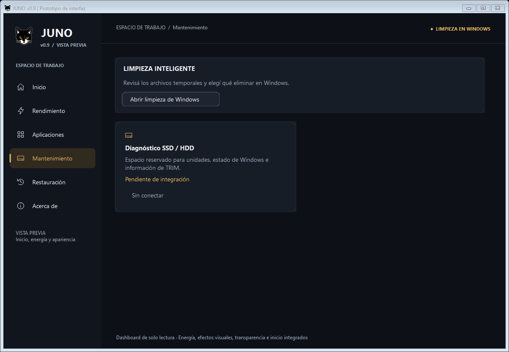
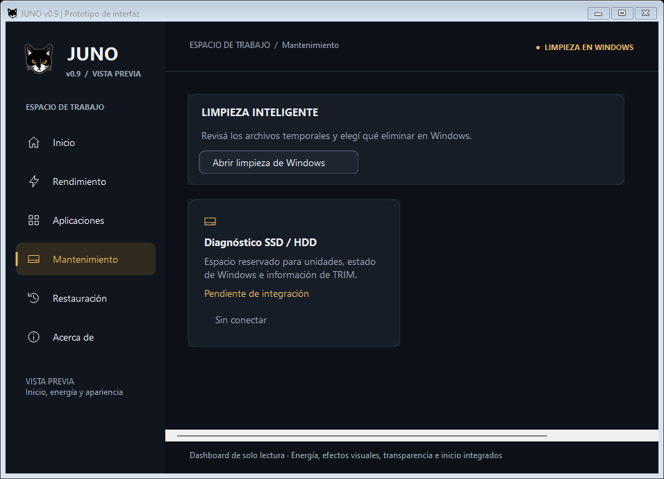
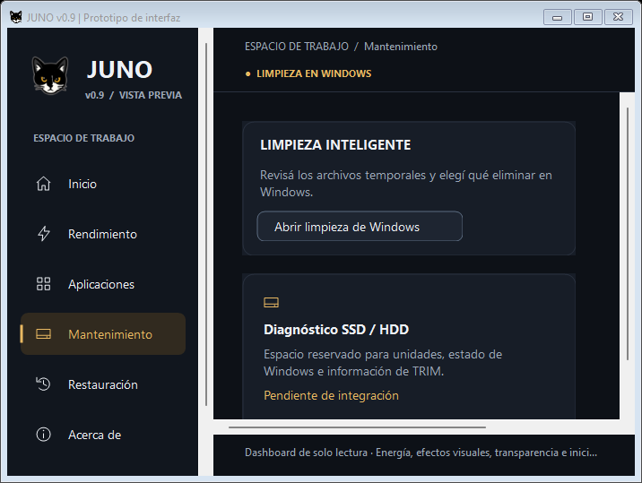
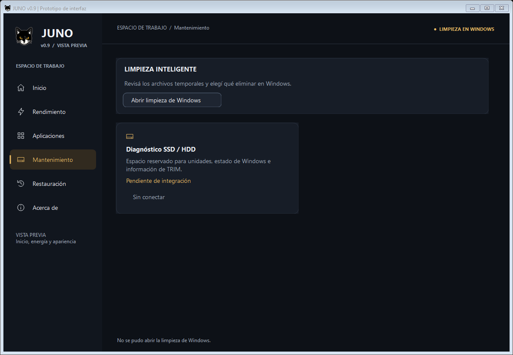

# JUNO v0.9 — Consolidación e integración de Limpieza inteligente

Fecha: 2026-10-22. Rama: feature/juno-ui-0.9.

> Nota posterior: el usuario aprobó esta integración. Se consolida mediante un commit local antes de comenzar Discos; las referencias a cambios sin commit y las verificaciones siguientes documentan el estado al entregar la etapa original.

## Consolidación de Git

Se revisaron estado, rama, historial, diferencias y archivos no rastreados antes de modificar archivos. Los bloques compartidos de JunoShell.cs y StartupBridge.Tests.ps1 se prepararon mediante snapshots del índice, sin reemplazar el árbol de trabajo. Cada contenido preparado se exportó y comprobó por separado.

Commits locales creados:

- c2e9dba — feat: simplify startup settings and preserve historical recovery. Sección mínima de inicio, consulta y restauración histórica desde Restauración, pruebas y reglas de UX.
- 4c10706 — feat: open Windows settings from power and transparency cards. Accesos oficiales de Energía y Transparencia, pruebas y reglas correspondientes.

No se realizó push ni merge. La integración nueva de limpieza descrita abajo queda sin commit.

Quedaron fuera, conservados y sin alteraciones:

- VisualDiagnostics.ps1, Juno-VisualDiagnostics.ps1, tests/VisualPersistence.NativeFake.cs, tests/VisualPersistence.Tests.ps1 y docs/0.9-efectos-persistencia.md.
- Juno.ico, Juno-icono.png y todos los archivos de Nueva carpeta/.
- StartupAdapter.ps1, ui/StartupModel.cs y dos cambios de tests/StartupBridge.Tests.ps1 del intento anterior de administrar entradas individuales. No son necesarios para la simplificación aprobada y se conservaron pendientes.
- docs/0.9-programas-inicio-ux.md y sus capturas docs/preview-0.9-inicio-ux/, correspondientes a la tabla rechazada y marcados como históricos.

## Auditoría previa del motor

Se revisaron Limpieza.ps1, UiSupport.ps1, tests/Cleanup.Tests.ps1, las pruebas de regresión y docs/0.8.1-etapa2.md antes de diseñar la integración.

| Función existente | Alcance y límites |
| --- | --- |
| Temporales de usuario | .tmp del primer nivel de LocalAppData/Temp; creación y modificación anteriores a siete días. |
| Temporales de Windows | .tmp del primer nivel de Windows/Temp; catorce días; accesos denegados sin elevar permisos. |
| Miniaturas | Patrones concretos thumbcache_*.db del primer nivel de Explorer; siete días; inventario, sin autorización para borrar. |
| Papelera | SHQueryRecycleBinW de lectura, con ABI x86/x64; tamaño y cantidad de todas las unidades como instantánea. |
| Seguridad del inventario | Máximo 5.000 entradas por categoría, sin recursión; rechaza rutas ajenas, ADS, UNC, dispositivos, puntos de reanálisis y antecesores redirigidos; omite archivos recientes, protegidos, bloqueados o modificados. |
| Ejecución asíncrona | Runspace de solo lectura, cancelación y descarte de resultados cancelados; no consulta al abrir la ventana clásica. |
| Eliminación por JUNO | Ninguna: CanDelete=false; Invoke-CleanCandidates devuelve cero eliminados y RecoveredBytes nulo, incluso con confirmación. |
| Limpieza delegada | Almacenamiento, cleanmgr.exe sin parámetros automáticos y Papelera; el usuario revisa y confirma en Windows. |
| Registros clásicos | Resumen sin nombres ni rutas personales; escritura fuera de los ámbitos de análisis; delegación y registros bloqueados en proceso elevado. |

El inventario suma longitudes lógicas de archivos que coinciden con reglas conservadoras. No certifica que sean prescindibles, no incluye todos los temporales y no demuestra cuánto espacio se recuperaría: hay archivos en uso, compresión, archivos dispersos, vínculos y cambios posteriores. Las comprobaciones por ruta no son atómicas. Extensión, edad y ubicación no autorizan borrado.

No existen respaldos de archivos borrados por limpieza. Los respaldos de ajustes de JUNO no revierten lo que el usuario confirme eliminar en Windows. No se añade eliminación automática, vaciado de Papelera, cierre de procesos ni ampliación de privilegios.

## Decisión de viabilidad

Es viable un acceso directo a la herramienta oficial de Windows. No se presenta el inventario de diagnóstico como una función de análisis de espacio recuperable: no ofrece esa garantía ni mejora el cálculo de Windows para el usuario habitual.

La interfaz mostrará únicamente el título, una descripción breve y Abrir limpieza de Windows. No habrá contador, tabla, resultados antiguos, tamaños inventados, botón Limpiar ni acciones decorativas. El motor clásico conserva su funcionalidad y sus protecciones; la integración moderna no lo invoca para analizar, delegar selecciones o escribir registros.

## Implementación nueva, sin commit

En Mantenimiento se reemplaza la tarjeta inactiva de limpieza por una sección compacta con exactamente tres controles: título, descripción y Abrir limpieza de Windows. Se retira la introducción genérica que anunciaba todas las operaciones como futuras. La tarjeta pendiente de discos permanece sin conectar. Se reutilizan Surface, fuentes, colores y PreviewButton secundario existentes.

El acceso abre ms-settings:storagesense por el shell, sin argumentos, elevación, confirmaciones adicionales ni espera al cierre. Es la misma página oficial de Almacenamiento que ya utilizaba el motor clásico; no es la página de políticas del Sensor de almacenamiento. Referencia: [Microsoft: URI de Configuración de Windows](https://learn.microsoft.com/en-us/windows/apps/develop/launch/launch-settings#system).

No importa Limpieza.ps1, no enumera archivos al entrar ni al pulsar el botón, no cambia Windows y no crea registros, respaldos o tareas. No muestra tamaños ni promete espacio liberado. La apertura es independiente del proceso de JUNO. Los errores reales muestran una frase en la barra existente y un reintento correcto elimina el aviso anterior. Se conservan los bloqueos durante otras operaciones y se recupera la disponibilidad al terminar.

Archivos nuevos o modificados de esta integración:
- ui/JunoShell.cs: sección compacta, inyección del acceso y aviso breve.
- ui/PowerPlatform.cs: WindowsCleanupSettingsLauncher con URI fija y apertura simulable.
- tests/Power.TestSupport.cs y tests/CleanupUi.Tests.ps1: proveedor ficticio y pruebas de la sección.
- tests/UiPrototype.Tests.ps1: una herramienta menos pendiente en Mantenimiento.
- docs/preview-0.9-limpieza/: cuatro capturas WinForms.
- Este informe.

## Validación visual y acceso real

Se ejecutó WinForms en Windows PowerShell 5.1 con proveedores ficticios, se mostró la ventana y se redimensionó. Las capturas se obtuvieron con DrawToBitmap del formulario nativo y se inspeccionaron visualmente. No son maquetas ni certifican clics humanos completos de la aplicación.

La sección mide 131 píxeles de alto a 1180×790 y 940×650, y 150 a 700×500. El texto se adapta y el botón permanece dentro de sus límites. Se revisaron el estado normal y un error de apertura simulado.

Se ejecutó también el lanzador real de producción. Mediante Computer Use se verificaron Sistema → Almacenamiento y el acceso a Archivos temporales en Windows 11. No se cambió ninguna selección, no se confirmó ninguna eliminación y no se activó ni desactivó el Sensor de almacenamiento. Las capturas del sistema con datos personales no se incorporan al repositorio.

Se detectó una limitación previa al reducir una ventana ya abierta: el contenedor general puede conservar un ancho virtual antiguo y mostrar una barra horizontal innecesaria. Se reprodujo por separado tanto en el árbol aprobado del commit 4c10706 como con la integración nueva: ancho virtual 901 y ancho de cliente 453 a 700×500. La sección y su botón siguen ajustándose. Esta tarea no modifica el contenedor global ni otras secciones para corregir ese defecto previo; las capturas de redimensionamiento lo muestran expresamente.

## Resultados de pruebas

- Primer commit, contenido exacto del índice exportado: 91/91 pruebas en PowerShell 5.1 x86 y 91/91 en x64; compilación C# y sintaxis de 41 scripts correctas en ambas arquitecturas.
- Segundo commit, contenido exacto del índice exportado: 10/10 pruebas específicas en x86 y x64; compilación y sintaxis de sus 42 scripts correctas.
- Suite completa del árbol consolidado de 4c10706: 19 archivos de pruebas, 702/702 casos distintos validados en x86 y 702/702 en x64, sin casos omitidos. La primera ejecución x64 fue 701/702: el proceso privado del prototipo agotó su espera de 20 segundos. La repetición aislada de UiPrototype aprobó 28/28 sobre la misma copia, sin cambios de programa ni plazos. El resultado final sustituye el caso repetido, sin sumar duplicados. Esta copia contiene exclusivamente los archivos versionados aprobados, sin iconos pendientes, Nueva carpeta/ ni los diagnósticos de persistencia no consolidados.
- Integración nueva en el árbol de trabajo: 170 casos relevantes distintos aprobados en x86 y 170 en x64. Suites CleanupUi, Cleanup, UiPrototype, ConfigurationButtons, Startup, Ux y Regression. Se incluyen 11 casos nuevos de UI y acceso oficial.
- En la primera ejecución combinada x64 aprobaron 169/170: el bootstrap clásico de un fixture superó su espera de 20 segundos bajo ejecución concurrente. La repetición aislada de Regression aprobó 30/30 sin cambiar el código ni ampliar plazos. Los 170 finales sustituyen el resultado anterior del mismo caso, sin contar duplicados.
- Compilación C# mediante Juno-Prototipo.ps1 -LoadOnly y análisis sintáctico de 46 scripts del proyecto: correctos en PowerShell 5.1 x86 y x64. Se excluye Nueva carpeta/ de ese recuento porque es material preservado ajeno al código activo.
- git diff --check correcto. El índice está vacío tras los dos commits; todos los cambios de limpieza siguen sin preparar ni confirmar.
- 48 huellas SHA-256 de archivos preservados y motores coinciden con las capturadas antes de las operaciones correspondientes. No se modificaron los cinco archivos de persistencia, los iconos, el material ajeno, Limpieza.ps1, UiSupport.ps1, los motores ni BackupStore.ps1.

Los casos de análisis, archivos bloqueados, permisos, rutas inaccesibles, protección de datos, límites y ausencia de borrados se ejecutan mediante las pruebas existentes del motor, con archivos privados de TestDrive. La nueva sección no implementa un analizador ni cálculos recuperables: no se inventan pruebas de carga o actualización de resultados que no ofrece. Sí se prueban error/reintento de apertura y deshabilitación/recuperación durante otras operaciones.

## Compatibilidad portable y límites

No se introdujeron rutas absolutas de repositorio en el producto, ejecutables auxiliares ni dependencias de instalación. La integración usa el shell oficial de Windows y los componentes C# ya cargados por el arranque modular de PowerShell 5.1. No se inició la creación ni el empaquetado de JUNO.exe.

Windows 10 requiere verificación física del acceso y del diseño; los casos con ese nombre comprueban el contrato simulado, no ejecutan ese sistema. Las capturas provienen de Windows 11. El ancho virtual residual del contenedor al reducir una ventana es un defecto previo, reproducido en la versión consolidada y documentado arriba. El diagnóstico de persistencia de efectos visuales sigue pendiente y no se considera resuelto por estos cambios.

## Prueba manual segura pendiente

En Windows 10 y 11, iniciar Abrir-Juno-Prototipo.cmd sin elevación, entrar en Mantenimiento y abrir la limpieza de Windows. Verificar Almacenamiento y el acceso de Windows a Archivos temporales. Volver a JUNO, cambiar de sección, redimensionar y repetir. No activar Sensor de almacenamiento ni confirmar borrados durante esta comprobación. Revisar las categorías de Windows antes de cualquier eliminación manual posterior: la selección y sus resultados pertenecen a Windows.
