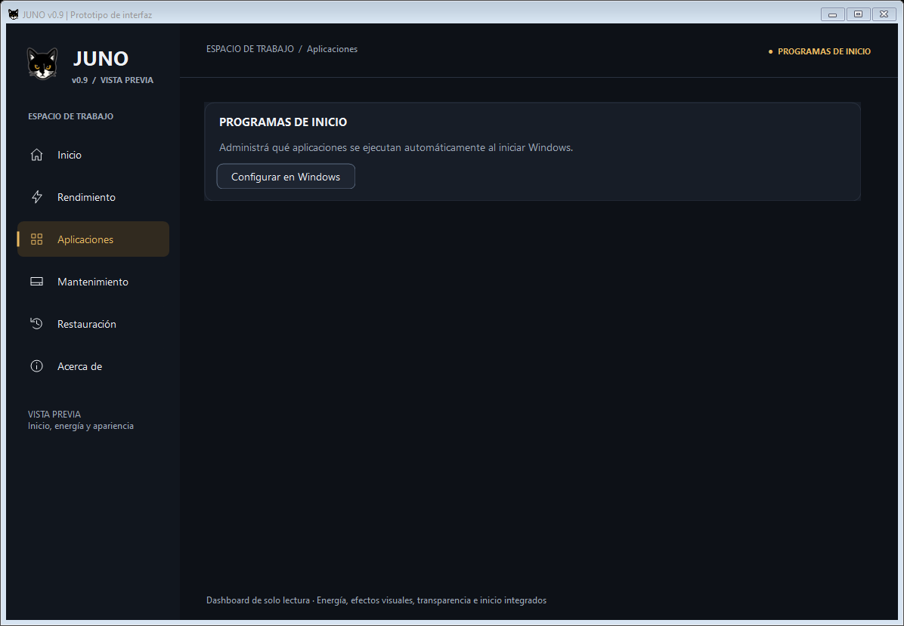
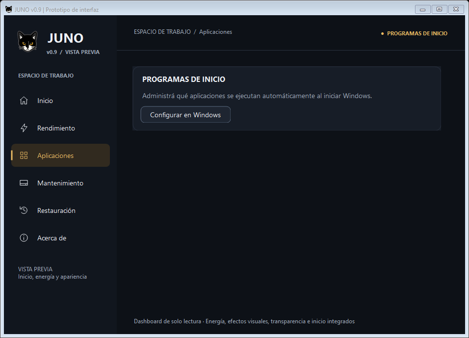
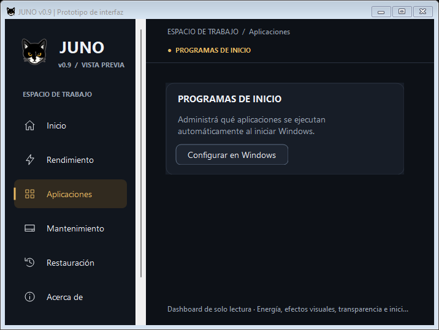

# JUNO v0.9 — Evaluación de permisos de segundo plano

Fecha: 2026-10-22. Rama: `feature/juno-ui-0.9`.

## Resultado

Se retiró por completo la integración moderna de Procesos en ejecución. **No se implementa una herramienta nueva de segundo plano**: no se demostró un mecanismo que permita a JUNO modificar los permisos personales de otras aplicaciones compatibles y comprobar su reconocimiento y eficacia, incluyendo Windows 11 Home, sin recurrir a métodos no documentados o ampliar el alcance a administración empresarial.

La sección queda eliminada, sin reemplazarla por un acceso al Administrador de tareas, otra configuración de Windows, una tabla vacía o un control decorativo. Aplicaciones conserva únicamente Programas de inicio, que es una función independiente ya aprobada.

Esto es una conclusión sobre la viabilidad de **esta integración de JUNO**, no una afirmación de que Windows carezca de permisos de segundo plano.

## 1. Eliminación y archivos

Antes de editar se revisaron Git y los diffs completos de la integración rechazada. El HEAD se conserva en `6fcca4e` — `feat: integrate disk maintenance access and fix horizontal scrolling`. No se creó ningún commit nuevo.

- `ui/JunoShell.cs`: retirados controlador, temporizador, consultas, acciones, estados y bloqueos exclusivos de procesos. No quedan lista, memoria, selección, Actualizar ni Solicitar cierre. Respecto al commit aprobado, el único cambio final del archivo elimina los dos espacios inactivos de Aplicaciones; `BuildApps` contiene únicamente `BuildStartup`.
- `tests/UiPrototype.Tests.ps1`: expectativa de cero herramientas inactivas en Aplicaciones y dos regresiones nuevas: contenido mínimo sin sustitutos y ausencia de componentes/conexión experimental.
- `Juno-Prototipo.ps1`, `ui/TransparencyConfirmation.cs`, `tests/Dashboard.Tests.ps1`, `tests/Power.Tests.ps1`, `tests/PowerBridge.Tests.ps1`, `tests/Transparency.Tests.ps1` y `tests/Ux.Tests.ps1`: devueltos al contenido aprobado, retirando exclusivamente las dependencias, conexiones y confirmación del experimento. No tienen diff final respecto a HEAD.
- Eliminados los seis archivos exclusivos: `ui/ProcessModel.cs`, `ui/WindowsProcessProvider.cs`, `ui/ProcessControls.cs`, `tests/Process.TestSupport.cs`, `tests/Process.Tests.ps1` y `tests/ProcessUi.Tests.ps1`.
- Retirados el informe no aprobado `docs/0.9-procesos-integracion.md` y sus ocho capturas de `docs/preview-0.9-procesos/`, para no presentar como vigente una integración rechazada.
- Añadidos este informe y tres capturas de la vista resultante en `docs/preview-0.9-segundo-plano/`.

Los archivos retirados tienen copia de trabajo previa fuera del árbol activo del repositorio, en el directorio privado de validación. No se borró ningún respaldo de configuración del usuario.

Se conservan `SegundoPlano.ps1`, `BackgroundInventory.ps1`, `PermisosUsuario.ps1`, `PermisosSegundoPlano.ps1`, `RecoveryOperations.ps1`, `BackupStore.ps1` y sus pruebas históricas. El cierre clásico de procesos tampoco se redefine como una restricción persistente ni se conecta a la interfaz moderna.

## 2. Qué aplicaciones y mecanismos admite Windows

| Entorno o aplicación | Capacidad documentada y límite |
| --- | --- |
| Windows 10 | Configuración → Privacidad → Aplicaciones en segundo plano permite cambiar individualmente las apps admitidas. Ese permiso no gobierna cualquier programa Win32. |
| Windows 11, incluido Home | Las apps que exponen la capacidad disponen de opciones de actividad en segundo plano en su configuración avanzada; «Nunca» impide esa actividad admitida mientras no se usa la app. No todas las aplicaciones ofrecen el control. |
| Win32 tradicional | Los controles anteriores no constituyen un bloqueo universal de escritorio. El comportamiento puede depender de las opciones de cada programa. |
| Paquete MSIX/Store | Tener un paquete o proceder de Store no demuestra ser UWP ni que todos sus componentes estén sujetos a esas restricciones. Puede contener escritorio, full trust o una mezcla. |
| UWP/AppContainer identificada | Es candidata a las reglas de ejecución de su modelo, pero leer su manifiesto no acredita por sí solo un permiso editable, su estado personal ni el efecto de una escritura externa. |

Fuentes: [Microsoft: aplicaciones en segundo plano y privacidad](https://support.microsoft.com/en-us/windows/privacy/windows-background-apps-and-your-privacy), [esquema Application y RuntimeBehavior/TrustLevel](https://learn.microsoft.com/en-us/uwp/schemas/appxpackage/uapmanifestschema/element-application).

La política `LetAppsRunInBackground` y sus listas por familia de paquete son mecanismos documentados **de equipo**, con soporte indicado para Pro, Enterprise, Education e IoT Enterprise desde Windows 10 1703. Home no figura entre las ediciones admitidas. Pueden prevalecer sobre la elección personal, afectar notificaciones/sincronización y requerir reiniciar la aplicación o el dispositivo. No son un sustituto general de los permisos del usuario de Home. No se aplicó un bloqueo global ni se intentó habilitar esas políticas en una edición inaplicable. [Microsoft: Privacy Policy CSP](https://learn.microsoft.com/en-us/windows/client-management/mdm/policy-csp-privacy#letappsruninbackground).

## 3. APIs revisadas y PowerShell 5.1

`BackgroundExecutionManager.RemoveAccess()` actúa sobre la aplicación que llama. La variante con identificador exige que la aplicación indicada pertenezca al **mismo paquete** que la llamante. No proporciona a un PowerShell de JUNO una operación general sobre paquetes ajenos. [Contrato oficial de RemoveAccess](https://learn.microsoft.com/en-us/uwp/api/windows.applicationmodel.background.backgroundexecutionmanager.removeaccess?view=winrt-26100).

`BackgroundExecutionManager.GetAccessStatus(applicationId)` tiene la misma restricción de paquete. Por ello tampoco resuelve la verificación independiente de todos los paquetes instalados desde JUNO. La elevación no amplía el contrato documentado de esa API. [Contrato oficial de GetAccessStatus](https://learn.microsoft.com/en-us/uwp/api/windows.applicationmodel.background.backgroundexecutionmanager.getaccessstatus?view=winrt-26100).

`AppResourceGroupInfo.StartSuspendAsync` inicia una transición de suspensión. No configura un permiso persistente y no funciona sobre grupos de tareas de segundo plano ni aplicaciones Desktop Bridge; no se utiliza como reemplazo de la función solicitada. [Contrato oficial de StartSuspendAsync](https://learn.microsoft.com/en-us/uwp/api/windows.system.appresourcegroupinfo.startsuspendasync?view=winrt-26100).

Desde PowerShell 5.1 se puede consultar inventario y manifiestos, identificar edición/build, comprobar ámbito y administración, validar respaldos y ejecutar restauraciones históricas sujetas a sus guardas. También es técnicamente posible escribir los valores de una política admitida con los permisos correspondientes. Eso no demuestra por sí mismo reconocimiento ni eficacia. No se encontró en las fuentes consultadas un cmdlet o contrato público que ofrezca el cambio personal arbitrario y su verificación por app ajena que requiere esta herramienta.

No se implementan escrituras de `Disabled`/`DisabledByUser`, automatización de clics de Configuración, desactivación de servicios, cambios de inicio ni suspensión/cierre de procesos para aparentar esa capacidad.

## 4. Capacidades y límites del motor de JUNO

Se revisaron las funciones de inventario, decisiones de compatibilidad, aplicación/restauración y almacenamiento; no se modificaron.

| Componente | Qué ofrece actualmente |
| --- | --- |
| `BackgroundInventory.ps1` | Paquetes del usuario deduplicados por PFN, manifiestos, distinción UWP/escritorio/mixto/desconocido y protección de componentes. Comprueba edición, build, ADMX, dominio/MDM y permisos antes de admitir políticas. Su clasificación «Compatible» describe el manifiesto, no un cambio personal verificado. |
| `PermisosUsuario.ps1` | `Assert-BPUApplySupported` bloquea nuevas solicitudes HKCU antes de respaldar o escribir. Conserva la restauración de los valores históricos. No se omite esa barrera. |
| `PermisosSegundoPlano.ps1` | Delega las políticas a `Invoke-JunoPolicy`; exige capacidades y permisos adecuados, sin apropiarse de configuración externa. La ventana clásica se conserva para sus usos y recuperación históricos. |
| `RecoveryOperations.ps1` | Revalida identidad del paquete, propiedad de las listas y conflictos; registra intención antes de escribir y verifica valores después. Conserva originales y conciliación de operaciones parciales. |
| Evidencia de efecto | El inventario devuelve `WriteConfirmed` cuando acredita la escritura, pero mantiene `PolicyRecognized = null` y `EffectiveVerified = false`. No hay un verificador independiente de ejecución efectiva que permita habilitar la nueva integración. |

### Persistencia y recuperación

Una política de equipo admitida puede ser persistente y sus valores pueden restaurarse mediante el diario de JUNO. El formato `Policy` conserva listas originales, presencia/ausencia del valor general, estado confirmado, intención pendiente y guardas de las listas externas. No debe sobrescribirse una política ajena para obtener un aparente éxito.

El formato histórico `BPU` conserva por SID y familia los valores `Disabled`/`DisabledByUser`, su presencia/ausencia y el estado de cada paso. La restauración comprueba usuario, ámbito y conflictos; no certifica con ello un permiso efectivo. Los respaldos inválidos, las claves desaparecidas o los conflictos conservan sus protecciones.

`BackupStore.ps1` mantiene validación de esquema/identidad/ámbito, almacenamiento protegido, comprobación de enlaces, escrituras protegidas y exclusión mediante mutex. No se altera el protocolo, no se importan respaldos reales ni se elimina ninguno. La recuperación existente sigue accesible desde el módulo clásico: `Abrir-Juno.cmd` → Revisar permisos de segundo plano → Restaurar seleccionadas, con sus validaciones y requisitos previos. La recuperación moderna de Inicio desde Restauración conserva su acceso.

## 5. Cómo acreditar reconocimiento y eficacia

Se deben separar tres evidencias:

1. **Persistencia:** los valores o la política quedaron registrados y sobreviven al ciclo previsto. Una relectura del Registro solo acredita este nivel.
2. **Reconocimiento:** Windows presenta el estado esperado en el control oficial pertinente o lo comunica a la propia app mediante su API documentada, después de las transiciones requeridas. Los estados de `BackgroundAccessStatus` deben interpretarse según su contrato y condiciones de energía; no son un indicador universal de todas las actividades de cualquier programa. [Microsoft: BackgroundAccessStatus](https://learn.microsoft.com/en-us/uwp/api/windows.applicationmodel.background.backgroundaccessstatus?view=winrt-26100).
3. **Efecto:** una aplicación de prueba instrumentada, con identidad y tarea conocidas, permite comprobar un disparador reproducible y su comportamiento antes/después y tras reiniciar cuando corresponda. No observar un proceso o una notificación durante unos minutos no demuestra que una app no pueda volver a trabajar en segundo plano.

Los puntos 2 y 3 no están resueltos por el motor actual para aplicaciones ajenas. Validar una app cooperante tampoco justificaría prometer la misma restricción para Win32, paquetes mixtos, componentes de seguridad o todo el catálogo instalado.

No se realizaron cambios reales para experimentar con estas hipótesis. Las simulaciones acreditan las guardas y el tratamiento de respaldos, no la eficacia de Windows sobre una aplicación real.

## 6. Decisión e implementación final

**No viable todavía bajo los requisitos solicitados.** Existe una forma documentada de establecer determinadas políticas en entornos admitidos, pero no se acreditó una administración personal por aplicación, verificable desde el JUNO actual y apropiada para Windows 10/11 Home. No se promueve una relectura de valores como prueba de eficacia ni se solicita elevación para sustituir el objetivo por una política de todas las cuentas.

La implementación final es únicamente la retirada de la herramienta rechazada, la ausencia de sustitutos y las regresiones de esa retirada. No se amplió el alcance con una nueva interfaz, servicio, paquete de pruebas instalable ni acceso a Windows. Cambiar el inicio, cerrar una app y restringir su permiso de segundo plano permanecen conceptos diferentes.

## 7. Validación

- **307/307 pruebas relevantes aprobadas en Windows PowerShell 5.1 x86 y 307/307 en x64**, sin fallos ni casos omitidos. Se ejecutaron doce suites: Startup, Background, BackgroundUi, UiPrototype, StartupBridge, Ux, ConfigurationButtons, CleanupUi, DiskUi, DiskAudit, Dashboard y Regression. No se presenta este resultado como una repetición de todas las suites históricas.
- Las simulaciones de segundo plano comprueban Windows 10/11 Home/Pro, manifiestos UWP/escritorio/mixtos, políticas ajenas, permisos insuficientes, bloqueo de solicitudes HKCU nuevas, separación entre escritura y eficacia, respaldos y restauraciones con conflictos. No se escribieron configuraciones reales.
- Las dos regresiones nuevas comprueban que Aplicaciones solo contiene Inicio y que ya no existen los componentes, método de solicitud ni dependencias de procesos. La navegación repetida no inicia operaciones de Inicio.
- Compilación C# desde Juno-Prototipo.ps1 -LoadOnly y sintaxis de los **48 scripts activos** correctas en ambas arquitecturas. Nueva carpeta/ queda preservada fuera de ese recuento.
- git diff --check correcto; el informe nuevo también supera la comprobación de espacios.
- **161 huellas SHA-256 de archivos preservados coinciden**. Incluyen motores, pruebas ajenas, respaldos del repositorio, diagnósticos e informe de persistencia, iconos, Nueva carpeta/ y los históricos de Inicio. No se tocaron almacenes personales de respaldo.
- HEAD y rama sin cambios; índice vacío. Los únicos archivos versionados con cambios nuevos respecto al contenido aprobado son ui/JunoShell.cs y tests/UiPrototype.Tests.ps1. Los otros cambios que Git sigue mostrando son los pendientes ajenos preservados.

Se mostraron ventanas WinForms nativas con proveedores no configurados para operaciones reales. Se inspeccionaron tres capturas: 1180×790, 940×650 y 700×500. La única sección de contenido es Programas de inicio, con alturas de 131, 131 y 150 px respectivamente; mantiene título, descripción y su botón aprobado. No hay tabla ni tarjeta vacía adicional, y no aparece barra horizontal al reducir y ampliar.

Queda pendiente la comprobación física de la presentación en Windows 10 y otras escalas DPI. No hay una nueva operación de permisos que se declare validada sobre Windows real. No se reabrió ni se declaró resuelta la investigación de persistencia de efectos visuales.

No se modificaron Registro, políticas, servicios, configuración de Windows ni respaldos reales. No hubo cierre de programas reales, optimización, limpieza o restauración. Sin commit, push ni merge en esta tarea.
