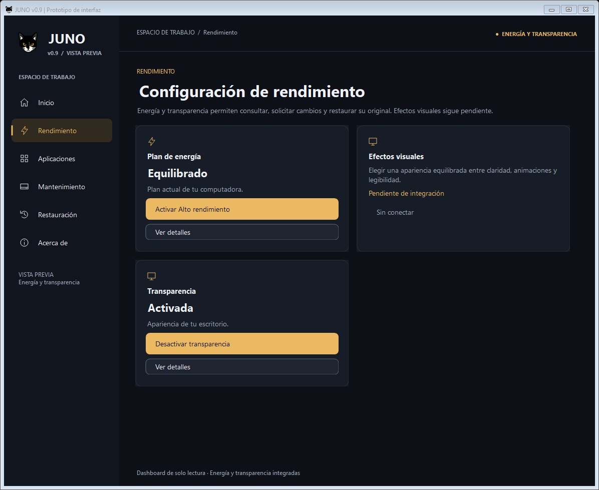
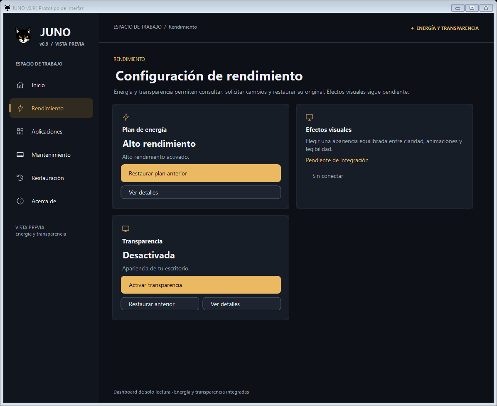
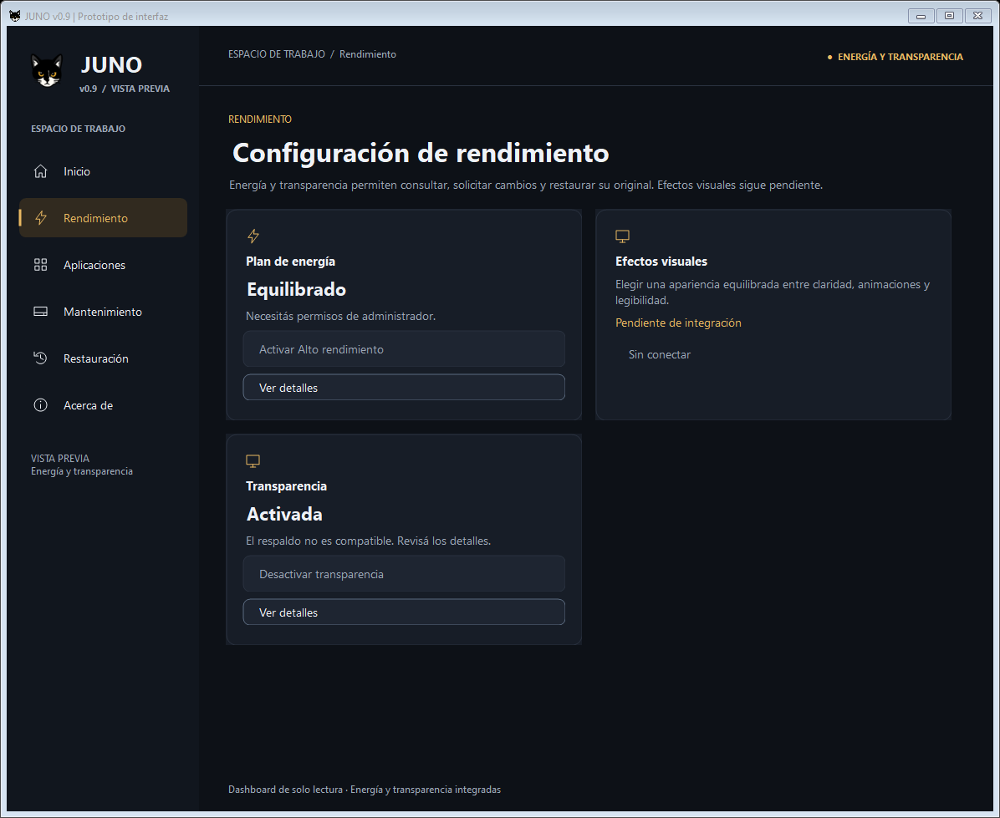
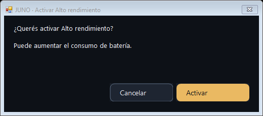
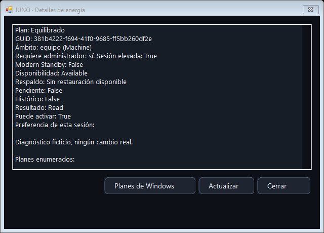

# JUNO v0.9 — Simplificación de la experiencia de usuario

Fecha: 21 de octubre de 2026. Rama: `feature/juno-ui-0.9`.

## 1. Problemas corregidos

Las tarjetas de energía y transparencia concentraban diagnóstico, advertencias y cuatro botones apilados. Ahora muestran nombre, estado, una acción principal y acceso discreto a detalles. La restauración aparece únicamente cuando el proveedor informa que está disponible.

- En energía, Equilibrado permite activar el plan identificado. Con Alto rendimiento o un plan elegido ya activo, desaparece la activación redundante; restaurar pasa a ser la acción principal si está permitido.
- Transparencia ofrece solo la acción opuesta al estado consultado. Un estado desconocido ofrece volver a consultar, sin destacar escrituras incompatibles.
- Los mensajes resumen errores, permisos, conflictos y operaciones pendientes. El mensaje técnico original, el resultado, los identificadores y los datos de recuperación permanecen en **Ver detalles**. También se avisa si desapareció el plan original.
- Las operaciones en curso conservan la última instantánea y deshabilitan las acciones incompatibles hasta recibir el resultado. Se mantienen la navegación, el bloqueo de solicitudes repetidas y la protección frente al cierre durante escrituras.
- **Ver detalles** permite leer el diagnóstico, actualizar la consulta y, en energía, abrir las opciones de planes de Windows. Consultar y navegar no autorizan cambios.
- La confirmación habitual pasa de 760 × 540 a 520 × 230 píxeles lógicos. El selector pasa de 680 × 500 a 540 × 330; sus identificadores se despliegan a pedido. Cancelar sigue siendo la opción predeterminada, tanto con Enter como con Escape.
- Las revisiones especiales de recuperación conservan el diálogo amplio y desplazable con toda la evidencia y su autorización adicional.

Se conservan colores, tipografía, icono, barra lateral y distribución general. El dashboard y las herramientas restantes no se modifican. En las capturas a escala 100 %, ambas tarjetas miden 253 píxeles de alto.

## 2. Archivos de esta corrección

| Archivo | Cambio |
| --- | --- |
| `ui/JunoShell.cs` | Tarjetas compactas, acción principal contextual, fila secundaria adaptable, selector compacto y ventana de detalles. |
| `ui/TransparencyConfirmation.cs` | Confirmación compacta habitual, revisión histórica completa y traducción de instantáneas a mensajes breves sin alterar el diagnóstico original. |
| `ui/TransparencyModel.cs` | Texto de la confirmación de transparencia; no cambia el motor ni el adaptador. |
| `ui/PowerModel.cs` | Confirmación breve y preferencia explícita únicamente en memoria de la sesión. |
| `PowerOperations.ps1` | Prioridad inequívoca del GUID oficial al resolver el destino, sin seleccionar por nombre ni crear planes. |
| `tests/Power.Tests.ps1` | Prioridad oficial sin duplicados y expectativas de la nueva tarjeta; lanzador de Windows verificado mediante un doble desde detalles. |
| `tests/Transparency.Tests.ps1` | Expectativas de una sola acción y mensajes breves, manteniendo las pruebas de operaciones y recuperación. |
| `tests/Transparency.TestSupport.cs` | Captura del título y mensaje de confirmación del proveedor ficticio. |
| `tests/Ux.Tests.ps1` | Casos específicos de presentación, diagnóstico, preferencias, cancelación, navegación y ventanas compactas. |
| `docs/0.9-simplificacion-ux.md` | Este informe. |
| `docs/preview-0.9-ux/*.png` | Cinco capturas del diseño con datos ficticios. |

El repositorio ya tenía cambios locales de Etapa 3B y de la corrección de duplicados. Se conservan; este informe enumera únicamente lo tocado por la simplificación. `Nueva carpeta/` queda fuera del trabajo.

## 3. Interacciones antes y después

Se cuentan clics desde Rendimiento con consulta terminada y permisos adecuados. No se incluyen abrir JUNO, navegar hasta la sección o elevar manualmente la sesión.

| Escenario | Antes | Después |
| --- | --- | --- |
| Oficial presente junto con personalizados | Acción, seleccionar fila, elegir, autorizar: **4** | Activar y confirmar: **2** |
| Oficial como único candidato identificado | Acción y autorizar: **2** | Activar y confirmación breve: **2** |
| Personalizados ambiguos, primera elección | Acción, seleccionar fila, elegir, autorizar: **4** | **4**, con selector compacto y detalles opcionales |
| Reutilizar una elección personalizada verificada durante la sesión, tras restaurar | Volver a elegir: **4** | Activar plan elegido y confirmar: **2** |
| Alternar transparencia | Acción y autorizar: **2** | Acción contextual y confirmación breve: **2** |
| Restaurar con respaldo actual válido | Acción y autorizar: **2** | Restaurar y confirmar: **2** |

El resultado verificado aparece automáticamente; no exige otra confirmación. La lectura inicial continúa siendo automática y secuencial entre ambas herramientas. Actualizar manualmente se desplaza a detalles: abrir detalles y pulsar Actualizar son dos clics. Los casos históricos conservan su revisión adicional, porque autoriza el uso de información anterior.

## 4. Capturas

**Todas estas imágenes son representaciones de Windows Forms con proveedores ficticios. No acreditan operaciones sobre Windows ni respaldos personales.** Se revisaron visualmente después de generarlas.

Equilibrado y transparencia activada:



Alto rendimiento activo y transparencia desactivada, con restauración disponible:



Permisos insuficientes y respaldo incompatible:



Confirmación habitual:



Diagnóstico bajo demanda:



## 5. Validación

Validación final en procesos nuevos, con Windows PowerShell **5.1.22621.6133** y Pester **3.4.0**:

| Comprobación | x64 | x86 |
| --- | --- | --- |
| Suite completa | **571/571 aprobadas**, 0 fallos, 0 omitidas | **571/571 aprobadas**, 0 fallos, 0 omitidas |
| Sintaxis PowerShell | **33 scripts**, sin errores | **33 scripts**, sin errores |
| Compilación C# mediante bootstrap `-LoadOnly` | Correcta | Correcta |

Se conservan los 544 casos anteriores, con las expectativas visuales y la prioridad oficial actualizadas, y se agregan **27 casos de UX**. Son 1.142 ejecuciones de pruebas aprobadas entre las dos arquitecturas. `git diff --check` termina sin incidencias.

La comparación SHA-256 de los scripts de la raíz contra el inicio de esta solicitud detecta únicamente el ajuste autorizado en `PowerOperations.ps1`; respaldos, recuperación, adaptadores y demás scripts conservan sus bytes. Las fuentes del dashboard también permanecen sin cambios. HEAD sigue en `eb4b2c7` y el índice no contiene cambios preparados.

Las pruebas de operaciones utilizan límites simulados, directorios privados y mutex de prueba. No se ejecutan cambios reales de planes, Registro, servicios, políticas, limpieza o restauración. Las capturas usan exclusivamente servicios controlados, sin consultar datos reales del equipo.

La nueva cobertura comprueba tarjetas con Equilibrado/Alto rendimiento, transparencia en ambos estados, restauración disponible o ausente, mensajes de permisos/respaldo/pendiente/conflicto/error, conservación del diagnóstico, confirmaciones breves con Cancelar predeterminado, recuperación amplia, elección explícita, reutilización tras restaurar, invalidación de preferencia, cancelación, reinicio de sesión y navegación con distintos anchos. La suite previa conserva selección ambigua, aplicación repetida, ausencia de duplicados, errores parciales, conflictos, compatibilidad, identidad, concurrencia y escalas lógicas de 100/125/150/200 %.

Para repetir la suite en cada arquitectura:

```powershell
Set-Location C:\GitHub\Juno
& C:\Windows\System32\WindowsPowerShell\v1.0\powershell.exe -NoProfile -ExecutionPolicy Bypass -Command "Import-Module Pester -RequiredVersion 3.4.0; Invoke-Pester -Script .\tests"
& C:\Windows\SysWOW64\WindowsPowerShell\v1.0\powershell.exe -NoProfile -ExecutionPolicy Bypass -Command "Import-Module Pester -RequiredVersion 3.4.0; Invoke-Pester -Script .\tests"
git diff --check
```

## 6. Garantías conservadas

El único ajuste PowerShell de esta etapa agrega la prioridad del GUID oficial `8c5e7fda-e8bf-4a96-9a85-a6e23a8c635c` en el resolvedor. Un nombre coincidente no acredita equivalencia. Si no está el oficial, se conservan las reglas conservadoras para candidatos personalizados y planes creados previamente. No se crea un plan por consultar o por elegir un candidato; la creación sigue requiriendo autorización explícita.

La preferencia de un personalizado se recuerda **solo después de aplicar y verificar ese GUID**, junto con su nombre, y únicamente durante la vida del controlador. Reutilizarla exige que siga presente con el mismo nombre entre los candidatos de la última consulta válida, con permisos, compatibilidad y elegibilidad vigentes, sin respaldo incompatible, estado histórico ni operación pendiente. Fallos, conflictos, pérdida de permisos, incompatibilidad, cambio de nombre o desaparición invalidan la preferencia. Cerrar JUNO la elimina. No se incorpora ningún archivo de preferencias ni se modifica el esquema del respaldo.

Cada nueva activación conserva su confirmación y envía el GUID explícito al servicio existente. El motor vuelve a enumerar y validar bajo el mutex antes de escribir: la preferencia visual no autoriza a omitir esa revalidación, crear sustitutos o corregir conflictos.

Se conservan el mutex, identidad de usuario/equipo, ACL, ámbitos User/Machine, formatos de respaldo, original, diarios de operaciones, comprobación posterior, reconciliación y revisión histórica. No se cambian los adaptadores ni los proveedores PowerShell de ejecución. Las fronteras de escritura de transparencia y el núcleo de recuperación quedan intactos respecto del inicio de esta solicitud.

No se agrega elevación automática: no existe un traspaso seguro de identidad y operaciones en curso en este flujo. La tarjeta indica que se necesitan permisos; detalles explica cerrar JUNO y abrirlo como administrador con la misma cuenta. No se utiliza otra identidad ni se ejecuta UAC durante el desarrollo.

## 7. Limitaciones e inspección manual

- Los planes realmente ambiguos requieren elección expresa. Personalizados con el mismo nombre se distinguen por número de opción y por GUID en detalles; no se afirma que sean equivalentes al oficial.
- La preferencia no sobrevive al cierre, y no comprueba que los ajustes internos de un mismo GUID permanezcan idénticos: recuerda el plan elegido, no certifica equivalencia de configuración. El motor conserva sus comprobaciones de existencia, plan activo, respaldo y conflicto.
- Un respaldo histórico exige una revisión adicional. Una incompatibilidad, conflicto o plan original desaparecido requiere investigar; JUNO no lo repara para ahorrar clics.
- Los cambios de transparencia pueden requerir cerrar sesión para reflejarse visualmente. JUNO no reinicia Explorer.
- No se validaron aquí cambios reales en Windows 10 y Windows 11 ni múltiples monitores con DPI físico distinto. Las escalas y medidas automatizadas no sustituyen esa comprobación visual.

Inspección manual sin aplicar cambios: abrir `Juno-Prototipo.ps1` con Windows PowerShell 5.1, visitar Rendimiento y esperar las consultas. Verificar que solo se destaque la acción compatible; abrir y cerrar detalles, actualizar, navegar por las secciones, reducir la ventana y comprobar el desplazamiento. Abrir una confirmación únicamente si la operación está habilitada y **cancelarla**; Enter y Escape deben cancelar. No confirmar activaciones, creación ni restauraciones durante una revisión de solo lectura. Para verificar estados que no coincidan con el equipo, usar las pruebas ficticias y las capturas, sin forzar configuraciones reales.

No se realiza commit, push ni integración con main. El trabajo queda local para revisión.
